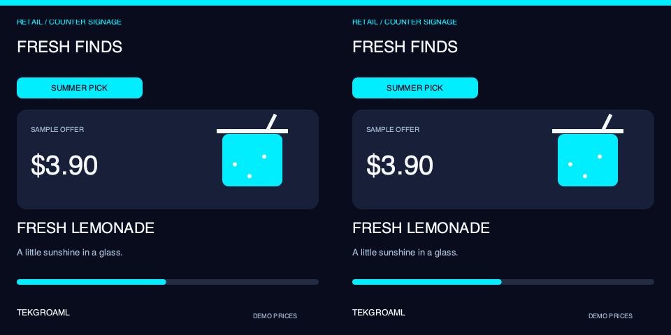

# TEKGROAML Raspberry Pi dual-display applications

**v0.10.2** groups same-content and different-content code, with separate round and square use cases and showcase scripts. Native system Python/GTK/Cairo; no browser, WebKit, LVGL, pip or virtual environment is needed. The repository retains its historical name; the Pygame path remains optional.

[中文](README_CN.md) · [Install and run over SSH](docs/raspberry-pi-ssh_EN.md) · [Standard commands](docs/standard-app.md) · [Demo catalog](demos/README.md) · [Scenes](scenes/README.md) · [Architecture](docs/architecture.md) · [Verification](docs/verification.md) · [Changelog](CHANGELOG.md)

| Display family | Three applications | Start command |
| --- | --- | --- |
| Same / round | Music visualization, RGB lighting, desktop clock | ./demos/same/round/demo start --port 1 |
| Same / square | Retail promotions, meeting-room status, parcel pickup | ./demos/same/square/demo start --port 1 |
| Different / round | Flight, automotive/motorcycle instruments, PC case | ./demos/different/round/demo start --port 1 |
| Different / square | Smart home, PC case, industrial pump station | ./demos/different/square/demo start --port 1 |

Each chapter introduces the brand and use case for3s, then runs the effect for10s;39s loop. Same-content introductions and effects are identical on both screens. Different-content introductions retain brand/icon on the left and use-case copy on the right. Square same-content applications are distinct businesses with full-square layouts, not cropped round pages.

All showcases use labeled simulated data. No audio playback, real prices, calendars, shipment/customer data or weather services. Square same-content passed Pi runtime checks; round same-content was updated and launched with the newly observed~71.295Hz input. Runtime evidence does not replace physical panel acceptance.



[Square same-content installation and39s preview](demos/same/square/README_EN.md) · [Round same-content](demos/same/round/README_EN.md) · [Round different-content](demos/different/round/README_EN.md) · [Square different-content](demos/different/square/README_EN.md)

## Install and run

Clone/copy the complete repository to~/apps/lvgl-embedded-gui-demos using the[SSH guide](docs/raspberry-pi-ssh_EN.md). Stop the old version before updating; do not copy only a scene directory. Keep the Pi's Wayland/labwc desktop logged in as the same ordinary SSH user.

```bash
cd ~/apps/lvgl-embedded-gui-demos
./setup.sh --install-only
./app --version
./app info --json
./demos/same/square/demo check --port 1
./demos/same/square/demo start --port 1
```

Stop separately with./app stop --port 1. start runs in the background after SSH exits while the desktop remains logged in. All scripts support check/start/run/status/logs/restart/stop. Restart preserves saved settings; recheck and start explicitly after changing boards. No automatic boot service is installed.

## Signal mapping

Both physical panels share one HDMI cable and driver board. port1/2 mapsHDMI-A-1/2 (Pi4 boardHDMI0/1), not left/right panel.

- Same-content default --signal clone: one480×480 input duplicated by hardware.
- Same-content --signal sbs: one960×480 input, software copies the same raster to each half.
- Different-content: one960×480 input with different left/right panels.

--size 480/720/800 layouts require supporting hardware. Square same-content480 clone profiles accept60Hz and the newly observed~62.811Hz input; other square profiles remain60Hz. Physical acceptance is separate. Round480 clone accepts60/~62.811/~71.295Hz; round480 SBS accepts60/~62.825Hz. Other sizes require60Hz. Scale1 and normal output rotation are required; no timing, EDID, resolution or touch configuration is changed. Panel dimensions alone do not establish driver-board compatibility.

## Code organization and compatibility

Actual applications live in scenes/same/round, scenes/same/square and scenes/different. Showcase orchestration lives in demos/same/round, demos/same/square, demos/different/round and demos/different/square. demos/shared owns timeline, command parsing and panel selection; common owns drawing primitives; scene_app owns runtime management.

Existing view/layout IDs remain valid. Old demo entrypoints product_showcase, square_showcase and same_showcase forward to round different, square different and round same respectively. Old Python imports re-export the same implementation classes, with no duplicate layout/model files. Stop old app versions before upgrading; private saved contexts remain version checked.

Standalone[PC monitoring](docs/pc-monitor.md) and the legacy mixed scene retain explicitly selected live JSON support. Demo never silently reads live sources. See[telemetry](docs/telemetry.md),[architecture](docs/architecture.md) and[verification](docs/verification.md) for practical limits and historical hardware evidence.
