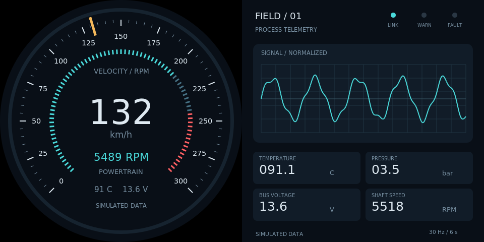
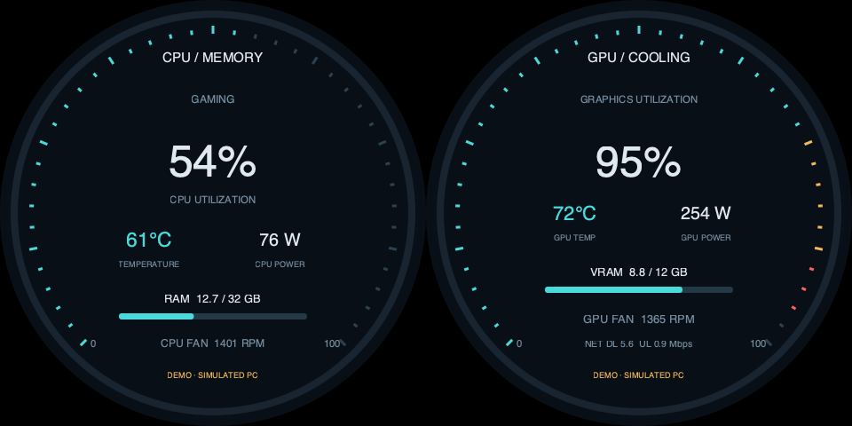
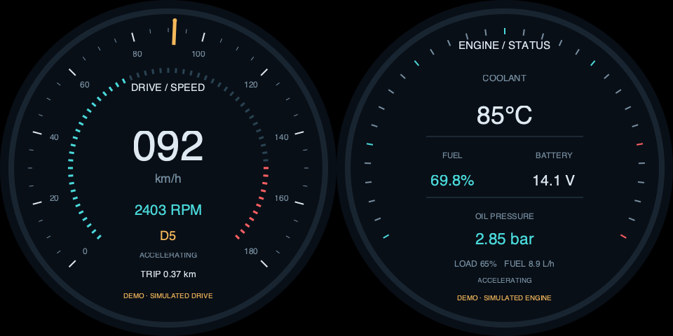

# Single-cable dual-panel instrumentation demos

**v0.6.1 software preview.** A standard ./app entrypoint now renders the existing automotive and industrial views with native Python/GTK3/Cairo. No browser, WebKit, LVGL, Pygame, pip or virtual environment is required by this path. Legacy Pygame scripts remain optional.



[中文](README_CN.md) · [Copy to Pi and run over SSH](docs/raspberry-pi-ssh_EN.md) · [Command reference](docs/standard-app.md) · [Telemetry protocol](docs/telemetry_EN.md) · [Verification](docs/verification.md)

## Product-use-case showcase

The independent demos/product_showcase directory loops flight → car/motorcycle → PC-case chapters. Each has a3s icon/title card and10s simulated effect,39s per loop, in one continuous native surface.

```bash
./app stop --port 1
./demos/product_showcase/demo check --port 1
./demos/product_showcase/demo start --port 1
```

After recording, stop with ./demos/product_showcase/demo stop --port 1. All effects remain simulated; the vehicle use-case label is not a motorcycle ECU integration. See the [standalone guide and39s preview](demos/product_showcase/README_EN.md).

## PC-case CPU/GPU display

New --view pc-monitor displays CPU/RAM on one circular panel and GPU/cooling on the other. Demo automatically transitions through idle, CPU rendering, gaming and cooling, with delayed temperatures/fans. Live consumes a timestamped JSON snapshot from the monitored PC, never the Pi's own metrics. Missing sensors remain unavailable, not fabricated zeroes.

```bash
./app stop --port 1
./app start --port 1 --shape round --panels 2 --input none --view pc-monitor --layout pc-monitor-sbs-480 --content different --data-source demo
```



An optional Windows PowerShell collector uses built-in CIM for CPU/RAM and an existing nvidia-smi for available GPU fields. It can upload atomic snapshots over already-configured SSH key access. It does not require Windows Python. CPU temperatures, fan RPM and unsupported GPU metrics stay null unless supplied by another real adapter. Real Windows/NVIDIA/transport acceptance is pending; see [full PC-monitor guide and protocol](docs/pc-monitor.md).

## Dedicated dual-round automotive scene

Left: road speed, RPM, gear and trip. Right: coolant temperature, fuel, voltage and oil pressure. Autonomous demo data follows an idle/accelerate/cruise/brake cycle with thermal lag, integrated fuel use and trip distance. No real OBD/vehicle control is declared.

```bash
./app stop --port 1
./app start --port 1 --shape round --panels 2 --input none --view automotive --layout automotive-sbs-480 --content different --data-source demo
```



The480 layout accepts60Hz and the observed native~62.825Hz at960×480 without changing hardware timing. Other sizes720/800 remain explicit60Hz layouts. Physical automotive acceptance remains pending; the existing flight app was not replaced in this change. See [car details and animation](docs/automotive.md).

## Observed dual-480 input

The connected dual-round product reports960×480 at approximately62.825Hz on HDMI-A-1, not60Hz. Its EDID detailed timing is44.43MHz with1360×520 total pixels. flight-sbs-480 layout v1.1.0 accepts both60Hz and this observed rate (±0.1Hz), without changing the display signal. Pi startup and actual surface binding succeeded; the user confirmed both physical circles complete, different content and automatic motion. This acceptance covers one setup only. See the verification record.

## New autonomous scenarios

| Shape | View | Two panels | Motion |
| --- | --- | --- | --- |
| round,round | flight | attitude/heading + airspeed/altitude/VSI | smooth climb/cruise/descent/level cycle with coordinated turns |
| square,square | industrial | pump station + process trends/health | idle/start/run/unload/cooldown with delayed temperature and cumulative flow |

```bash
./app start --port 1 --shape round --panels 2 --input none --view flight --layout flight-sbs-480 --content different --data-source demo
./app stop --port 1
./app start --port 1 --shape square --panels 2 --input none --view industrial --layout industrial-sbs-480 --content different --data-source demo
```

Demo data moves automatically with a shared simulation clock, without external devices or interaction, and is visibly marked simulated. Flight altitude derivatives match VSI, bank and heading follow coordinated turns, and pump temperature lags load. The two new views are demo-only; live requests are rejected. Optional demo_speed=2 in examples/demo-fast.json accelerates the full cycle without changing HDMI refresh. See [scenario details and accelerated animated previews](docs/scenarios.md).


## Original mixed-view launch

On Raspberry Pi OS Bookworm Desktop/labwc, as the normal user who owns the logged-in Wayland session:

```bash
cd ~/apps/lvgl-embedded-gui-demos
./setup.sh --install-only
./app --version
./app info --json
./app check --port 1 --shape round,square --panels 2 --input none --layout automotive-industrial-sbs-480 --content different
./app start --port 1 --shape round,square --panels 2 --input none --layout automotive-industrial-sbs-480 --content different --data-source demo
./app status --port 1
./app logs --port 1 --follow
./app stop --port 1
```

Use port2 consistently if wired to HDMI-A-2; port1 is HDMI-A-1 (Pi4 board HDMI0), port2 is HDMI-A-2 (board HDMI1). Two panels share one HDMI canvas, not two connector instances. The profile is **left round/right square, no touch, different content**. Single-panel, touch and same-content requests are rejected. Dual-round uses the new flight view and dual-square uses industrial, with matching dedicated layouts.

| Explicit software layout | Full input canvas at 60Hz | Each panel |
| --- | --- | --- |
| automotive-industrial-sbs-480 | 960×480 | 480×480 |
| automotive-industrial-sbs-720 | 1440×720 | 720×720 |
| automotive-industrial-sbs-800 | 1600×800 | 800×800 |

New flight-sbs-* and industrial-sbs-* layouts use the same three canvas sizes. These mappings describe software geometry, not a certified driver-board product. Confirm the actual full input mode and left/right splitting first. The industrial view uses square corners and is not round-safe. Normal rotation and100% scale are required; no timing, resolution, EDID or USB mapping is changed.

## Minimal runtime and lifecycle

setup.sh only installs missing distribution Python/GTK/Cairo/layer-shell/wlr-randr packages and never launches the application. Existing dependencies require no download. Use the ordinary desktop user, without sudo for app commands.

SSH discovers the same user's unique active Wayland session. The app matches the connector geometry to a unique monitor and binds its layer-shell surface explicitly; SDL enumeration is not used. Ambiguous mirrored geometry and unsupported modes are rejected.

start supervises a background run, returning only after actual drawing, data readiness and output binding. It can continue after SSH disconnects while the desktop remains logged in. Ctrl+C in logs only stops following logs. run is the foreground debug alternative; restart uses saved settings. Per-user connector locks and private control sockets prevent other projects from being stopped or replaced accidentally. No reboot autostart is installed.

The optional screen-test tool can run first: stop any current app, run tap-cycle, physically observe, then stop that test and start the app. Neither screen-test nor pi-setting is required.

## Demo and live

Demo is explicit and ignores any configured input file. Live uses --data-source live --config <file>, with examples/live.json specifying config_version=1, fps and input_file. Relative data paths resolve next to the configuration. Rendering fps 10–60 is separate from HDMI refresh.

Only the original automotive-industrial view accepts live JSON. A real adapter must atomically update complete validated snapshots; the example telemetry JSON is static and becomes stale after three seconds. Missing/invalid/stale data never turns into demo. Initial live readiness requires a fresh valid snapshot; later failures retain last values, show DATA STALE and report degraded health. Background file reads do not block GTK drawing. This application reads telemetry only, sends no hardware control commands and is not an automotive or industrial protection system.

## Legacy and validation

./setup.sh --legacy-pygame installs optional legacy dependencies and creates the Pi-local .venv used by ./run.sh automotive --sbs --size 480. The legacy renderer uses zero-based SDL --display indexes, not Linux connector numbers. Stop an old tekgroaml-instruments.service before using the new interface.

scene_app contains the CLI, lifecycle, configuration, output matching and Cairo painter; gauges preserves existing view/telemetry logic, layouts holds versioned SBS maps, and tests covers the standard contract and data/lifecycle regressions.

The previous mixed-view release passed actual Pi Cairo offscreen checks at 960×480/1440×720/1600×800. The new release passed 38 unit tests, six scene/size offscreen renders and multi-phase animated-preview checks; see the verification record. The new on-screen dual-panel surface, physical driver-board mapping and long-duration performance remain unverified. See the self-contained SSH guide and verification record.

## Per-scene architecture

Each scenes/<id>/ owns scene.py, model.py, panels (or panel modules) and layouts/. registry.py selects factories. common/ contains the shared theme, Cairo renderer, components, simulation helpers and bounded JSON telemetry. scene_app/ owns the standard CLI, HDMI binding, locks and GTK lifecycle without per-scene branches. gauges/ and scene_app/painter.py retain thin compatibility exports.

Existing flight, industrial and automotive-industrial commands/layout IDs remain valid. Capabilities are generated from the registry with python3 scripts/update_manifest.py (--check verifies synchronization). Copy the full project including common/ and scenes/ when updating; no adjacent repository is required. See [architecture and adding scenes](docs/architecture.md).
