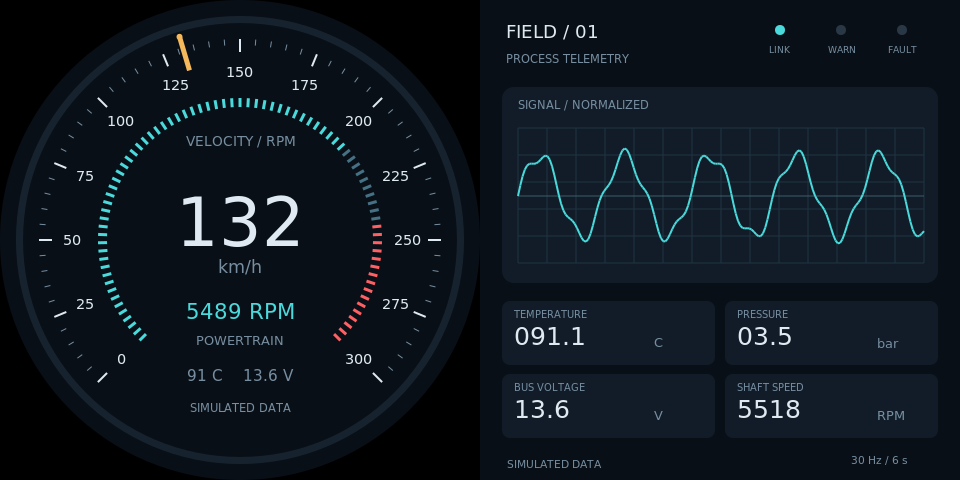

# 单线双屏汽车与工业仪表演示

**v0.2.0 软件预览版**：已按统一规范提供./app入口，默认采用原生Python+GTK/Cairo，和圆形触摸看板使用同类运行方式。无需浏览器、WebKit、LVGL、Pygame、pip或虚拟环境；只有旧run.sh路径需要另装Pygame。



[English](README.md) · [复制到Pi并通过SSH运行](docs/raspberry-pi-ssh.md) · [标准命令](docs/standard-app.md) · [遥测协议](docs/telemetry.md) · [验证记录](docs/verification.md) · [版本记录](CHANGELOG.md)

## 它是什么

一根HDMI信号线连接双屏驱动板，一个完整画布分成左右两块：左边汽车速度/转速仪表，右边工业波形/指标面板。两个面板显示不同内容，但可使用同一份遥测数据。

当前声明的组合为：**round,square + panels2 + input none + content different**。右侧工业面板利用方形四角；并未适配双圆屏。单屏、双圆、触摸和同显暂不支持，传入这些请求会返回明确错误。

仓库名保留lvgl-embedded-gui-demos，不代表使用LVGL。标准入口重新使用原有仪表/遥测业务代码，通过Cairo绘图适配器渲染；旧Pygame入口仍保留。

## 树莓派启动

先按驱动板要求配置好完整输入画布，在Raspberry Pi OS Bookworm/labwc桌面用户的SSH终端执行：

```bash
cd ~/apps/lvgl-embedded-gui-demos
./setup.sh --install-only
./app --version
./app info --json
./app check --port 1 --shape round,square --panels 2 --input none --layout automotive-industrial-sbs-480 --content different
./app start --port 1 --shape round,square --panels 2 --input none --layout automotive-industrial-sbs-480 --content different --data-source demo
./app status --port 1
./app logs --port 1 --follow
./app stop --port 1
```

接口2接线时统一改--port 2。port1/2对应HDMI-A-1/2（Pi4板子HDMI0/1），不是SDL显示索引。panels2代表该**一个输出**内两个面板，不代表两根HDMI线。

支持显式选择的三份软件布局：

| layout | 完整画布与信号 | 每面板 |
| --- | --- | --- |
| automotive-industrial-sbs-480 | 960×480、60Hz | 480×480 |
| automotive-industrial-sbs-720 | 1440×720、60Hz | 720×720 |
| automotive-industrial-sbs-800 | 1600×800、60Hz | 800×800 |

它们是已实现的软件分区，**未认证具体驱动板/产品**。必须先确认硬件接受该完整信号且按左右分区；仅有两个480面板并不保证支持960×480。程序不会改分辨率、刷新率、时序、EDID、缩放或USB映射。不匹配时拒绝启动，不自动拉伸。

## 依赖、桌面和运行管理

默认安装器只补缺失的发行版Python、GTK3/Cairo、GTK layer-shell和wlr-randr包；全已有时无需下载。它不自动启动、不默认安装Pygame，也不需要pip编译。运行以普通用户执行，不加sudo。

SSH自动发现同一用户的唯一Wayland桌面；Pi须已经登录桌面。标准入口按连接器读取几何并将全屏surface绑定唯一monitor，不依赖枚举顺序。镜像歧义、缩放非100%、输出旋转或错误模式会拒绝。

./app start后台启动并等待绘图/数据/窗口定位就绪，SSH断开后可继续运行，前提是图形桌面保持登录；./app run使用相同参数前台调试。日志Ctrl+C只退出查看，stop只停止本项目，不关闭别的屏幕或其他Python程序。

./app restart --port 1使用保存的配置和布局版本。相同参数重复start幂等；同项目同版本可--replace并在失败时尝试恢复；其他项目占口必须先由原项目正常stop。没有自动安装开机启动。

## 从屏幕测试切换

如已装可选screen-test，可先执行screen-test tap-cycle --screen 1，手动观察点击切色；完成后screen-test stop --screen 1，再执行上面的./app start。反过来测试前先./app stop --port 1。screen-test/pi-setting不是本项目依赖。

## 真实JSON遥测

默认demo始终模拟，不根据环境或配置偷偷选择真实数据。live明确读取外部采集器持续更新的JSON文件，不提供采集驱动或任何车辆/工业控制写入。

```bash
cp examples/live.json ~/instruments-live.json
nano ~/instruments-live.json
./app start --port 1 --shape round,square --panels 2 --input none --layout automotive-industrial-sbs-480 --content different --data-source live --config ~/instruments-live.json
```

先将input_file设置为真实采集器的快照路径；相对路径按配置文件目录解析。示例telemetry.json只是一份静态协议样本，三秒后过期，不能当作真实采集器。初次没有新鲜有效数据不报告ready；运行后失效保留最后值并标记DATA STALE/健康degraded，不切回demo。文件读取放在后台线程，不阻塞绘图。

配置支持config_version=1、fps（10～60，默认30）和input_file。fps是渲染目标，不是HDMI刷新率。协议、范围、原子更新和采集扩展见[数据文档](docs/telemetry.md)。

## 代码结构与旧入口

```text
app / screen-app.json       标准入口和精确能力声明
scene_app/
  cli.py / runtime.py       命令、后台监督、共享口租约和控制socket
  config.py / display.py    显式布局、配置与真实输出匹配
  worker.py / painter.py    GTK全屏生命周期和Cairo绘图适配
layouts/                   版本固定的三份SBS分区
examples/                  模拟配置、live配置、静态协议样本
gauges/                    原有汽车/工业视图、波形和遥测逻辑
tests/                     合同/归属/布局/遥测检查和离屏绘图
run.sh / requirements.txt   保留旧Pygame入口（可选）
```

如需旧路径，显式./setup.sh --legacy-pygame，再./run.sh automotive --sbs --size 480；该路径仍用SDL索引，不能声称支持标准--port定位。旧临时服务tekgroaml-instruments.service运行时，先systemctl --user stop tekgroaml-instruments.service，再用./app。

本地25项测试通过，Pi临时目录通过24项基础测试，三种尺寸原生离屏绘图已验证；尚未打开新标准入口的实体双屏窗口，也未确认驱动板分割/长期性能。软件预览不等于硬件认证，详见验证记录。
