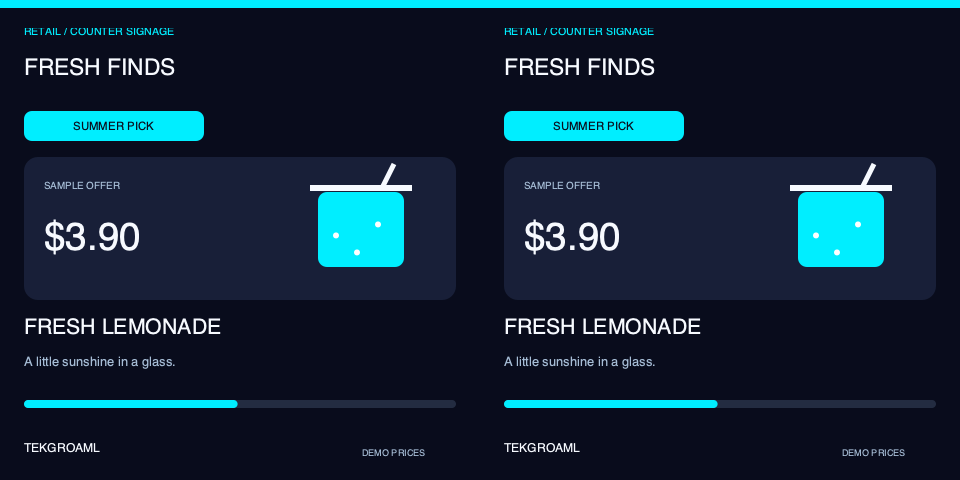

# TEKGROAML 树莓派双屏应用与产品演示

**v0.10.0**：按同显／异显组织代码，提供圆形和方形四类独立演示。使用系统Python＋GTK/Cairo，无需浏览器、WebKit、LVGL、pip或虚拟环境。仓库名称保留历史LVGL字样；旧Pygame入口仍可选。

[English](README.md) · [安装到Pi与SSH启动](docs/raspberry-pi-ssh.md) · [标准命令](docs/standard-app.md) · [演示总目录](demos/README.md) · [场景目录](scenes/README.md) · [代码结构](docs/architecture.md) · [验证记录](docs/verification.md) · [版本记录](CHANGELOG.md)

## 四类演示

| 关系／形状 | 应用场景 | 启动脚本 |
| --- | --- | --- |
| 圆形同显 | 音乐律动、RGB氛围、桌面信息钟 | ./demos/same/round/demo start --port 1 |
| 方形同显 | 门店促销、会议室状态、物流取件 | ./demos/same/square/demo start --port 1 |
| 圆形异显 | 飞机、汽车／摩托仪表、PC机箱 | ./demos/different/round/demo start --port 1 |
| 方形异显 | 智能家居、PC机箱、工业泵站 | ./demos/different/square/demo start --port 1 |

每组先介绍品牌与场景3秒，再展示动态应用10秒，三组共39秒循环。同显介绍和效果均两屏一致；异显介绍左品牌／图标、右用途说明，效果两屏内容不同。方形同显的业务和布局独立于圆形，不只是改变裁剪形状。

所有产品演示使用明确标识的模拟数据，不播放声音，不连接真实业务。方形同显新增场景只在本地验证；显示屏已断开，本次未更新或启动树莓派。



[方形同显完整39秒预览与安装说明](demos/same/square/README.md) · [圆形同显](demos/same/round/README.md) · [圆形异显](demos/different/round/README.md) · [方形异显](demos/different/square/README.md)

## 安装和SSH启动

按[完整指南](docs/raspberry-pi-ssh.md)克隆或复制整个仓库到~/apps/lvgl-embedded-gui-demos。已有旧版先正常stop，再更新完整项目，不能只复制一个场景目录。使用登录桌面的普通用户，不加sudo启动应用。

```bash
cd ~/apps/lvgl-embedded-gui-demos
./setup.sh --install-only
./app --version
./app info --json
# 选择一种脚本，例如方形同显
./demos/same/square/demo check --port 1
./demos/same/square/demo start --port 1
```

演示后台运行，SSH退出后继续，Wayland/labwc桌面须保持登录。结束时单独执行./app stop --port 1。不同场景共用端口锁，切换前正常停止；restart沿用保存的布局和参数，换板后重新check/start。

## 接线和输入

一个HDMI信号连接双屏驱动板，两个面板共用一个输出。--port 1/2对应HDMI-A-1/2（Pi4板标HDMI0/1），不是左／右面板。

- 同显默认--signal clone：输入一张480×480图像，驱动板复制给两个屏。
- 同显--signal sbs：输入960×480，软件把同一画面复制到左右区。
- 异显：输入960×480，左右各画不同内容。

每种脚本有--size 480/720/800布局，需硬件真实支持。方形同显仅声明60Hz；圆形同显480布局允许此前实测的clone约62.811Hz或SBS约62.825Hz。其他尺寸60Hz。不能按两块480面板推断驱动板接受960×480。程序检查缩放100%、无输出旋转，不更改时序、EDID、分辨率或USB触摸映射。

若已安装可选screen-test，切换前先screen-test stop --screen 1；pi-setting不是本仓库依赖。当前应用不提供触摸操作。

## 代码结构与兼容

```text
app / screen-app.json       标准入口和生成的能力清单
scene_app/                 生命周期、进程、锁、桌面与HDMI定位
common/                    绘图、模拟校验、卡片与矢量组件
scenes/
  same/round/              音乐、RGB氛围、信息钟
  same/square/             门店促销、会议室、取件
  different/               飞行、汽车、家居、PC、工业等
  registry.py              显式注册表
demos/
  same/round/              圆形同显编排与介绍
  same/square/             方形同显编排与介绍
  different/round/         圆形异显编排与介绍
  different/square/        方形异显编排与介绍
  shared/                  公共时间轴、命令、页面选择
```

旧demos/product_showcase/demo、square_showcase/demo、same_showcase/demo保留转发；旧view、layout ID、端口含义保持兼容。旧场景Python导入也转发到同一实现，不保留第二套布局。应用版本变化须先停止旧实例；已有私有context带版本，不自动绕过版本校验。

单独PC场景可用明确的live JSON数据，详见[PC指南](docs/pc-monitor.md)与[遥测协议](docs/telemetry.md)；demo不偷偷切换真实源。旧混合场景保留live协议，失效保留最后有效值并标记stale，不回退模拟。

本地软件验证不等于实物产品认证。[验证记录](docs/verification.md)区分历史Pi测试、用户观察与本次本地证据。
