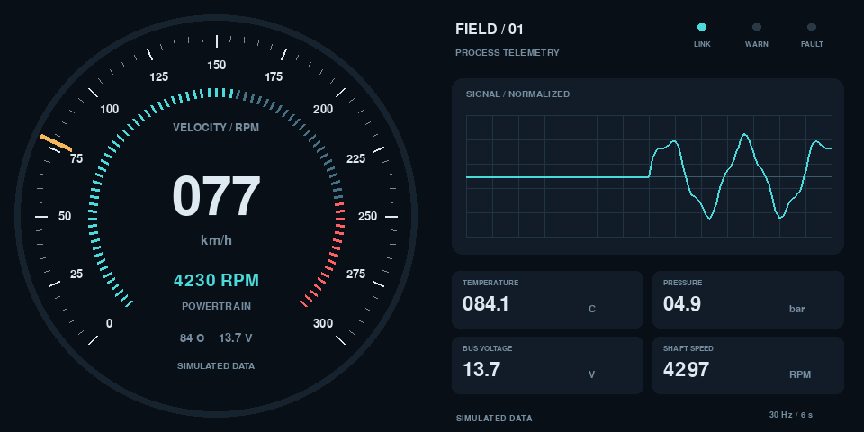

# 嵌入式仪表与工业界面演示

  

[English](README.md)

面向小型 HDMI 屏幕的圆形汽车速度/转速仪表与方形工业面板。虽然仓库沿用 `lvgl-embedded-gui-demos` 名称，**实际交付的渲染器是 Pygame，并非 LVGL 或 Python-LVGL 绑定**。这是按需求允许的 Python/Pygame 技术栈实现，避免树莓派上的平台相关 LVGL 绑定编译。数据与渲染边界便于后续移植到 LVGL。



## 文件结构

```text
lvgl-embedded-gui-demos/
├── docs/
│   └── preview.png
├── examples/
│   └── telemetry.json
├── gauges/
│   ├── __init__.py
│   ├── automotive_gauge.py
│   ├── common.py
│   └── industrial_panel.py
├── tests/
│   └── test_telemetry.py
├── .gitignore
├── README.md
├── README_CN.md
├── requirements.txt
├── run.sh
└── setup.sh
```

## 硬件与安装

断电后将树莓派 HDMI0 接到驱动板 HDMI 输入（Pi 4/5 使用 micro-HDMI），按规定为两者供电。此演示可不接 USB 触摸/数据线。使用配套硬件指南设置原生 480×480 或 720×720，桌面缩放为 100%。汽车界面位于圆形可视范围内；工业面板利用方形四角，适合方屏。

适用于 Raspberry Pi OS Bookworm/Bullseye 桌面版，或具备正常 Wayland/X11 桌面的 Debian：

```bash
chmod +x setup.sh run.sh
./setup.sh                       # Installs and launches automotive fullscreen
./setup.sh industrial            # Installs and launches industrial fullscreen
./setup.sh --install-only
./run.sh automotive
./run.sh industrial --size 720 --fps 30
./run.sh automotive --windowed   # Development monitor
```

APT 安装 Debian 的 Pygame/SDL，`--system-site-packages` 虚拟环境使用该版本；系统模块不可用时，才通过固定版本的 `requirements.txt` 回退安装 Pygame 2.6.1。Debian 版本可能是较早的 2.x。无需全局 pip 修改、外部字体、图片素材、OpenGL 绑定或网络服务。请以桌面用户运行，不要加 sudo。全屏会检查桌面尺寸，但不会修改 HDMI 时序，也不配置直接 DRM 控制台渲染。

也可用虚拟环境 Python 直接运行要求的入口文件：

```bash
.venv/bin/python gauges/automotive_gauge.py --windowed
.venv/bin/python gauges/industrial_panel.py --windowed
```

## 仪表与操作

汽车界面包含 0–300 km/h 刻度、0–8,000 RPM 转速环、沿外缘移动的指针、数字速度/转速、温度与电压。指针按经过时间平滑跟随遥测，6,500 RPM 起显示红线告警，冷却液温度 95 °C 起告警。模拟数据会反复扫过刻度和告警范围。

工业界面包含归一化波形、连接/警告/故障指示灯，以及温度、压力、总线电压和轴转速。波形以 30 Hz 保存 180 个样本（六秒），与渲染帧率无关。JSON 以 5 Hz 轮询，两次更新之间保持数值，因此它**不是硬件示波器，也不是 30 Hz 数据采集设备**。无效或过期样本会形成间断，不伪造波形。压力 8 bar 起告警，电压低于 11 V 时告警。

| 按键 / 选项 | 功能 |
| --- | --- |
| Esc / `Q` | 退出 |
| 空格 | 仅暂停/恢复模拟，实时输入不会被此键冻结 |
| Tab | 单屏时切换两种视图 |
| `--fps 30` | 降低渲染负载 |
| `--display N` | 选择物理 SDL 显示器 N |
| `--sbs` | 单个宽窗口：A/左屏汽车仪表，B/右屏工业面板 |
| `--frames N --screenshot PATH` | 有限帧运行并保存最终 PNG |

双 480×480 驱动板可运行：

```bash
./run.sh automotive --sbs --size 480
```

桌面应设为 **960×480**，保持 100% 缩放且不旋转整张画布。驱动板的唯一 HDMI 接口接收一张 SBS 图像，两个方形表面对应 A/B，不是两路扩展桌面。`--size 720 --sbs` 需要驱动板和桌面实际支持 1440×720。`--sbs` 固定两侧视图，Tab 不改变其位置。

## 通过 JSON 快照接入真实遥测

```bash
./run.sh automotive --windowed --input-file examples/telemetry.json
```

示例文件只是静态协议样本，文件修改时间超过三秒后会显示 **DATA STALE**。真实适配器至少每三秒发布一次原子快照，建议以 5 Hz 更新。以下六个有限数值字段全部必填：

| 字段 | 单位 / 允许范围 |
| --- | --- |
| `speed` | km/h，0–300 |
| `rpm` | RPM，0–9,000（可视转速环在 8,000 饱和） |
| `temperature` | °C，−40–150 |
| `pressure` | bar，0–20 |
| `voltage` | V，0–60 |
| `signal` | 归一化幅度，−1–1 |

`TelemetrySource` 最多读取 64 KiB，拒绝缺失、非有限或超范围字段，出错时保留上次有效值并标记过期，绝不会把失效的真实数据悄悄换成模拟。请保持树莓派时间准确，数据新鲜度由文件修改时间判断。写入时，在**同一文件系统**创建临时文件，再调用 `os.replace`：

```python
import json
import os
from pathlib import Path

def publish_snapshot(destination, values):
    destination = Path(destination)
    temporary = destination.with_name(destination.name + ".tmp")
    temporary.write_text(json.dumps(values, allow_nan=False))
    os.replace(temporary, destination)
```

每个目标文件只保留一个写入进程。辅助函数接收 `examples/telemetry.json` 所示的完整字典，真实测量由采集适配器提供。渲染留在主线程，串口/蓝牙/USB 读取应放在独立进程中，不能让 GUI 等待 ECU 或 PLC。

## OBD-II、工业与 LVGL 移植

OBD-II 可通过独立适配器结合 `python-obd` 和兼容 ELM327 设备，在支持时读取车速、转速、冷却液温度和电压，明确换算单位后发布快照。压力和归一化信号必须来自真实可用传感器或有明确意义的映射，不能将虚构值标为实时数据。缺失 PID 应显示不可用/过期，协议请求应有超时和重连处理。仓库不提供 OBD-II 驱动，也不会发送车辆控制命令。此演示用于台架原型，行车仪表需要独立验证。

工业遥测可使用独立 Modbus/MQTT/串口适配器，明确工程单位、边界和采样时间戳，再映射到相同协议，或扩展 `Telemetry` 及校验。内置告警阈值只是示例，不是认证控制或保护逻辑。

移植到 LVGL 时，保留采集/校验边界，用 LVGL scale/arc/label/chart 对象替换 `Painter` 与视图绘制方法，在 LVGL 事件/定时器循环中更新，适用时保留单帧缓冲区的 SBS 拆分。MCU 上还需要真实显示/输入驱动、flush 回调、颜色格式和内存预算。仓库名称不代表包含 Python-LVGL 绑定。

## 无桌面检查与问题排查

```bash
./run.sh automotive --headless --frames 180 --screenshot /tmp/automotive.png
./run.sh industrial --headless --frames 180 --screenshot /tmp/industrial.png
./run.sh automotive --sbs --headless --frames 180 --screenshot /tmp/sbs.png
```

无桌面运行采用 SDL dummy 驱动及固定模拟时间步，可验证绘图和生命周期，不能验证真实树莓派性能、HDMI 时序或屏幕拆分。

| 问题 | 处理方式 |
| --- | --- |
| 全屏尺寸不符 | 配置原生方形/宽屏桌面，或传入 `--windowed`。 |
| 波形平直或过期 | 检查 `signal`、原子更新、文件权限和三秒新鲜度窗口。 |
| 圆屏裁掉工业标签 | 使用方屏，或把卡片布局调整到圆形安全区域。 |
| 帧率偏低 | 使用 `--fps 30`，关闭后台特效，检查过热降频。 |
| Pygame 或显示错误 | 运行安装脚本，通过 `run.sh` 启动，在桌面内运行且不要加 sudo。 |
| SBS 左右互换 | 检查 A/B 排线顺序、缩放和准确画布尺寸。 |

硬件、真实传感器集成与特定树莓派部署仍需在实际系统中验证。

## 开发验证

```bash
python3 -m unittest discover -s tests -v
```

3 项标准库测试覆盖核心配置、行为或输入/API 边界。开发验证在 macOS 上完成，并非树莓派硬件实测。已检查 Shell 语法和 Python 编译，并对适用的交互演示进行渲染。APT 安装及实际树莓派启动/桌面仍需实机检查。

较旧 Bullseye 镜像可能只有 Pygame 1.x，此时安装器会安装 SDL2/编译依赖；没有可用 wheel 时将编译固定版本的 Pygame 2，请预留额外安装时间与磁盘空间。
