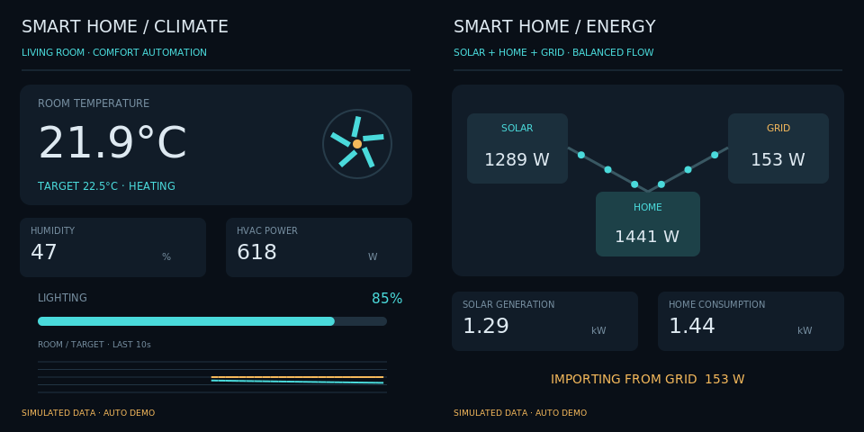
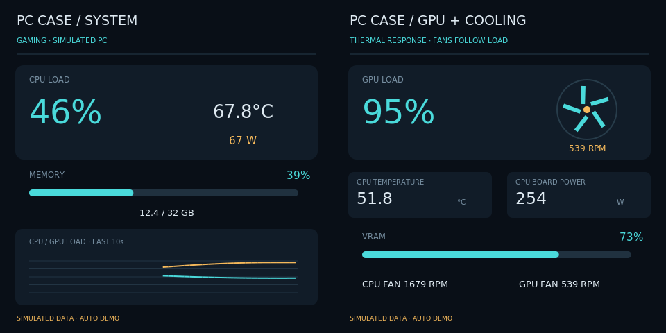
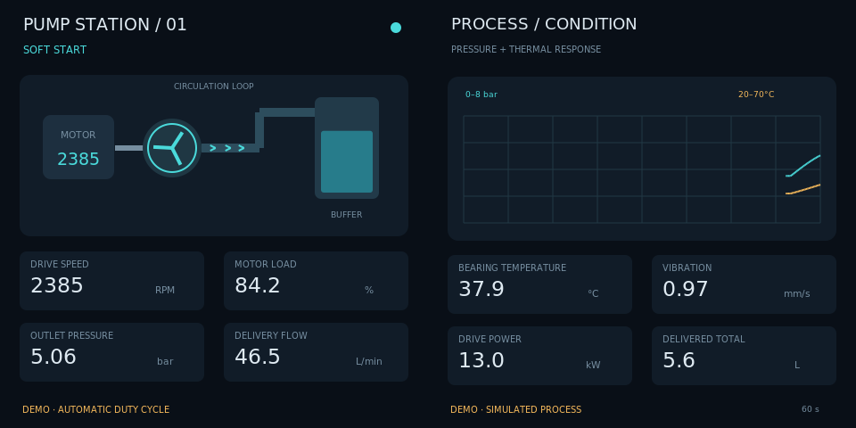

# 方形双屏产品用途演示

[English](README_EN.md) · [场景目录](../../../scenes/README.md) · [SSH安装指南](../../../docs/raspberry-pi-ssh.md)

适合一根HDMI信号线驱动的左右两块方形屏幕。默认每屏480×480，整张输入960×480；不是两个HDMI口各接一块屏幕。使用原生Python/GTK/Cairo，无需浏览器、WebKit、pip或新运行依赖。版本0.7.0。

## 三个用途，一轮39秒

| 顺序 | 用途 | 左屏10秒动态效果 | 右屏10秒动态效果 |
| --- | --- | --- | --- |
| 1 | 智能家居 | 温度、目标温度、湿度、灯光、空调功率与旋转风扇 | 光伏、家庭用电、电网输入／输出及流动指示 |
| 2 | PC机箱状态屏 | CPU负载、温度、功率、内存和负载趋势 | GPU负载、显存、温度、功率与风扇转速 |
| 3 | 工业设备监控 | 泵站动画、转速、负载、压力和流量 | 压力／温度趋势、振动、功率和累计供液量 |

每段先显示3秒介绍：**左屏是TEKGROAML品牌和用途图标，右屏是应用说明及左右屏指标**。随后两屏分别显示10秒应用效果。39秒后返回家居介绍，持续循环，切换共享一个窗口。

数据始终标为模拟，不采集真实家庭、PC或工厂数据，也不控制设备。PC沿用既有负载／热惯性模型；家居满足光伏+电网=家庭用电；泵站累计流量递增、温度滞后于负载。短片从活动阶段开始，数据和动画自动变化，无需触摸。

## 写入树莓派

先停止旧应用，再更新完整仓库；不要只复制本目录。桌面保持登录，同一桌面用户通过SSH操作，不使用sudo启动应用。

首次安装可在Pi上执行：

```bash
git clone https://github.com/tekgroaml/lvgl-embedded-gui-demos.git ~/apps/lvgl-embedded-gui-demos
cd ~/apps/lvgl-embedded-gui-demos
./setup.sh --install-only
./app --version
```

GitHub代码需已包含0.7.0；开发中未推送时按[SSH安装指南](../../../docs/raspberry-pi-ssh.md)从电脑复制完整仓库。现有Git副本升级时，先在旧版本执行./app stop --port 1，再git pull --ff-only和./setup.sh --install-only。

## SSH启动

在完整项目根目录执行：

```bash
cd ~/apps/lvgl-embedded-gui-demos
./app stop --port 1
./demos/different/square/demo check --port 1
./demos/different/square/demo start --port 1
```

上面start启动后台演示，SSH断开后继续播放，前提是桌面会话保持登录。需要停止时再单独执行：

```bash
./demos/different/square/demo stop --port 1
```

状态与日志：

```bash
./demos/different/square/demo status --port 1
./demos/different/square/demo logs --port 1 --follow
```

status中telemetry.scene依次为smart-home、pc-monitor-square、industrial，phase为intro或effect，cycle_index是循环次数。restart --port 1沿用已保存的场景。不同版本升级须先正常stop。

等价统一入口也可选择方形：

```bash
./demos/different/round/demo start --port 1 --shape square
```

原圆形入口默认仍是圆屏，或显式--shape round。切换形状前先./app stop --port 1。标准命令等价于：

```bash
./app start --port 1 --shape square --panels 2 --input none --view product-showcase-square --layout product-showcase-square-sbs-480 --content different --data-source demo
```

## 尺寸和接线

接口①使用--port 1，对应HDMI-A-1（Pi4板标HDMI0）；接口②使用--port 2。左右面板共用所选接口的一个SBS信号。

| --size | 每块面板 | 完整输入信号 | 接受刷新率 |
| --- | --- | --- | --- |
| 480（默认） | 480×480 | 960×480 | 60Hz或约62.825Hz |
| 720 | 720×720 | 1440×720 | 60Hz |
| 800 | 800×800 | 1600×800 | 60Hz |

例如demo start --port 1 --size 800。程序只检查并使用已有信号，不更改分辨率、EDID、像素时钟或刷新率。显示缩放须100%、无输出旋转。实际驱动板必须支持所选完整信号和左右分区；两块方屏并不自动等于960×480兼容。尺寸不是由EDID名称推断。

## 单独运行某一用途

先停止当前演示，然后选择一条命令：

```bash
./app stop --port 1
# 智能家居
./app start --port 1 --shape square --panels 2 --input none --view smart-home --layout smart-home-sbs-480 --content different --data-source demo
```

```bash
./app stop --port 1
# PC机箱
./app start --port 1 --shape square --panels 2 --input none --view pc-monitor-square --layout pc-monitor-square-sbs-480 --content different --data-source demo
```

```bash
./app stop --port 1
# 工业设备
./app start --port 1 --shape square --panels 2 --input none --view industrial --layout industrial-sbs-480 --content different --data-source demo
```

三个方形场景均仅demo。圆屏原有pc-monitor的live能力不会自动转移到本演示。

## 代码和文案

playlist.json维护场景顺序、英文标题、左右指标说明和3秒/10秒时长。固定三个已声明的方形demo，禁止递归播放或live源。修改后stop/start，配置摘要会随播放列表变更。demo_speed须为1，防止拍摄时长被加速。

实际页面分别位于scenes/different/smart_home/、scenes/different/pc_monitor_square/和scenes/different/industrial/。common/square.py提供方屏页头、条形指标、风扇和有界趋势图；PC复用scenes/different/pc_monitor/model.py。播放时钟、图标、品牌／应用分屏介绍及标准生命周期复用已有产品演示代码，圆形播放列表保持独立。







预览由实际Cairo绘图生成，不能替代实体屏幕完整性和闪烁的现场确认。验证范围见[验证记录](../../../docs/verification.md)。

目标Pi已从旧版本正常停止、备份并升级到0.7.0，接口1启动product-showcase-square成功。连续43秒监测覆盖全部六个场景/阶段、进入下一轮、帧数持续增加，状态始终running/ok；输入保持960×480@62.825001Hz。此结果确认运行状态，实体显示仍待用户观察。
