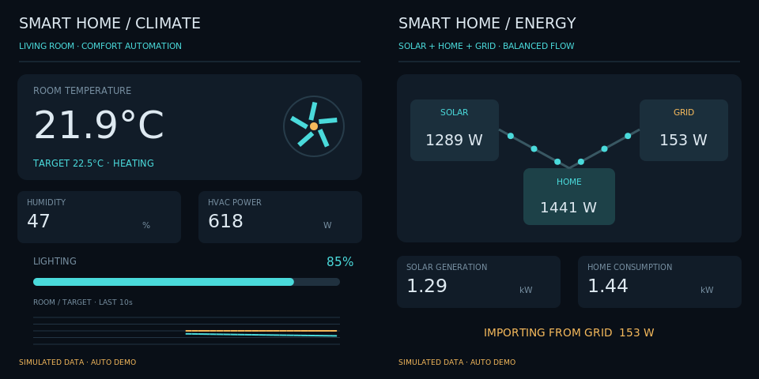
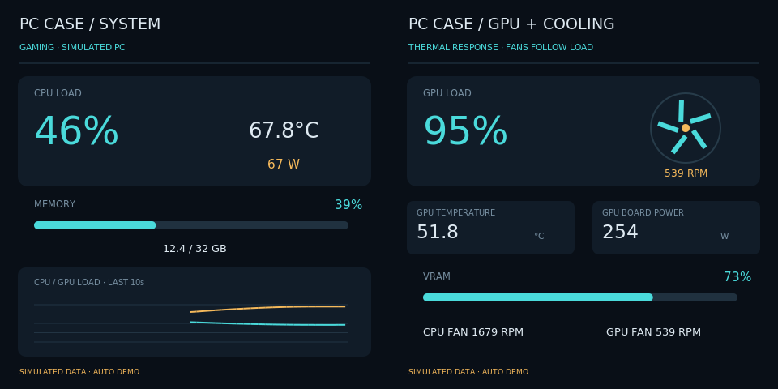
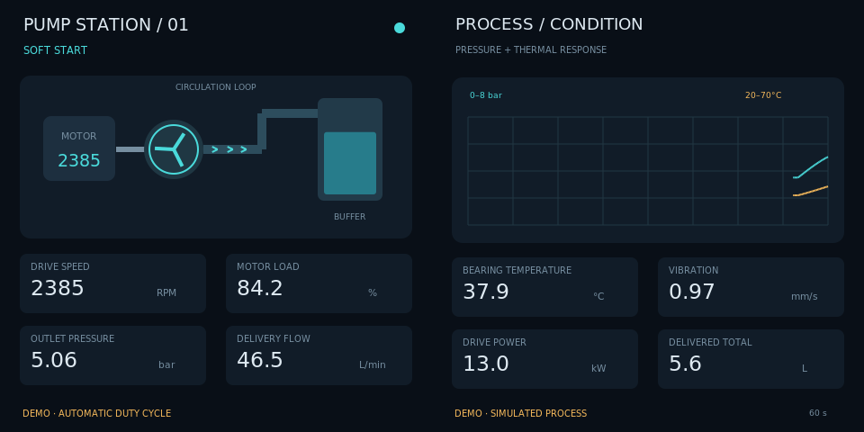

# Dual-square product showcase

[中文](README.md) · [SSH installation](../../../docs/raspberry-pi-ssh_EN.md)

Version0.7.0. One HDMI signal drives two square panels side by side. The default is two480×480 panels in a960×480 canvas. Native Python/GTK/Cairo; no new dependencies.

| Use case | Left display | Right display |
| --- | --- | --- |
| Smart home | Temperature, humidity, lighting, HVAC and fan animation | Solar/home/grid power with directional energy flow |
| PC case | CPU, RAM, power, temperature and load history | GPU, VRAM, power, temperature and animated cooling |
| Industrial monitoring | Pump, speed, pressure, flow and load | Trends, vibration, temperature, power and delivered volume |

Each chapter begins with a3s introduction: brand/icon on the left, application description and panel roles on the right. Each effect runs10s; all three loop every39s. All data is explicitly simulated; no real home, PC or industrial control is connected.

## Install and launch over SSH

Copy the complete repository, including common, scenes, demos and scene_app. Keep the Pi desktop logged in as the same user. Stop the old app before updating code. For a fresh installation, once GitHub contains0.7.0:

```bash
git clone https://github.com/tekgroaml/lvgl-embedded-gui-demos.git ~/apps/lvgl-embedded-gui-demos
cd ~/apps/lvgl-embedded-gui-demos
./setup.sh --install-only
./app --version
```

For existing Git installations, stop the old application first, then git pull --ff-only and rerun setup. For local unpublished changes, transfer the complete project using the [SSH guide](../../../docs/raspberry-pi-ssh_EN.md).

```bash
cd ~/apps/lvgl-embedded-gui-demos
./app stop --port 1
./demos/different/square/demo check --port 1
./demos/different/square/demo start --port 1
```

Run stop separately when finished:

```bash
./demos/different/square/demo stop --port 1
```

Use status --port 1, logs --port 1 --follow, or restart --port 1. start runs in the background and survives SSH disconnection while the desktop remains logged in. The shared wrapper also accepts./demos/different/round/demo start --port 1 --shape square. The original default remains round.

## Display requirements

port1 meansHDMI-A-1 (Pi4 boardHDMI0); port2 meansHDMI-A-2. Both panels share the selected connector. Default480 accepts960×480 at60Hz or the observed~62.825Hz, ±0.1Hz. Add --size 720 or --size 800 only for supported1440×720 or1600×800 inputs at60Hz. Scale1 and normal output rotation are required. No signal, EDID, clock or timing settings are changed. EDID names do not establish the physical panel shape.

The standard equivalent is:

```bash
./app start --port 1 --shape square --panels 2 --input none --view product-showcase-square --layout product-showcase-square-sbs-480 --content different --data-source demo
```

## Separate scenes and implementation

Stop the current demo first. For a standalone scene use the same standard command with matching --view and --layout:

| --view | --layout |
| --- | --- |
| smart-home | smart-home-sbs-480 |
| pc-monitor-square | pc-monitor-square-sbs-480 |
| industrial | industrial-sbs-480 |

All three square scenes support demo data only. PC telemetry follows the existing CPU/GPU thermal model; smart-home solar+grid balances household consumption; pump temperature lags load and delivered volume accumulates. Fans, flows, values and histories change automatically.

Edit playlist.json for bounded copy and3s/10s durations. Its digest participates in instance identity; restart after edits. demo_speed must remain1. Scene data/pages live in scenes/; common/square.py shares dashboard drawing helpers. Timeline, title roles and lifecycle reuse the existing round showcase without changing its playlist. See[verification](../../../docs/verification.md); physical square-panel acceptance still requires observation.






