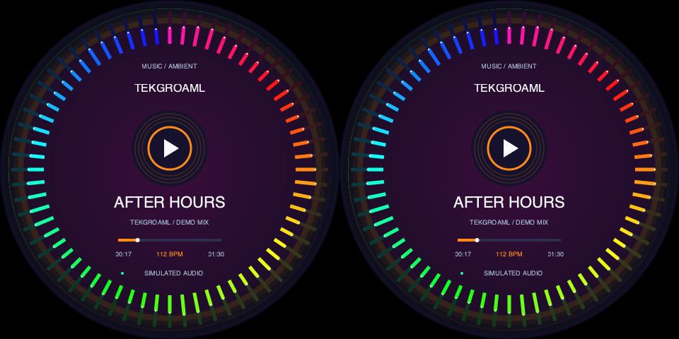
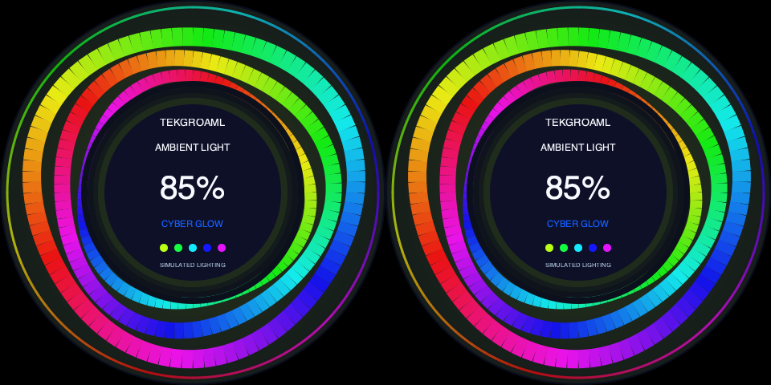
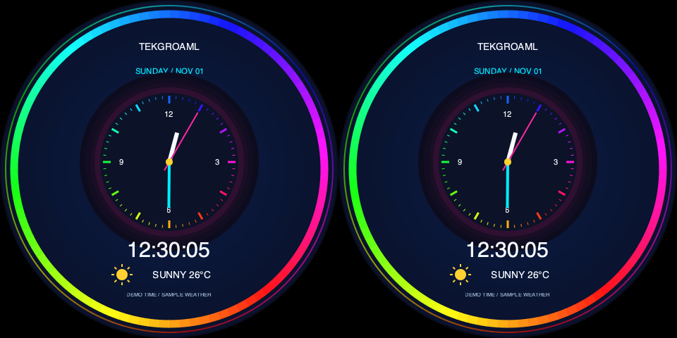

# 双圆同显：三种产品用途循环演示

[English](README_EN.md) · [演示目录](../../README.md) · [SSH安装指南](../../../docs/raspberry-pi-ssh.md)

v0.10.2，面向桌面、机箱、展台和亚马逊产品展示。每段介绍3秒、动态效果10秒，一轮39秒。**介绍页与效果页两屏都显示相同内容**，风格为鲜艳的霓虹色彩。

| 时间 | 场景 | 画面 |
| --- | --- | --- |
| 0～3秒 | 音乐介绍 | TEKGROAML品牌、音符图标、用途文案 |
| 3～13秒 | 音乐律动 | 彩虹频谱、节拍光环、模拟播放信息 |
| 13～16秒 | 氛围介绍 | 品牌、灯光图标、用途文案 |
| 16～26秒 | RGB氛围 | 三条流动色带、呼吸亮度模拟、自动配色 |
| 26～29秒 | 信息钟介绍 | 品牌、时钟图标、用途文案 |
| 29～39秒 | 桌面信息钟 | 彩色表盘、模拟指针／数字时间、示例天气 |
| 39秒起 | 返回音乐介绍 | 持续循环，直到stop |

[完整39秒动态预览](preview-loop.gif)。全部为模拟：不播放或采集声音，不获取真实天气，也不控制物理灯带或屏幕背光。时钟明确标记DEMO TIME。预览由真实Cairo绘图缩小导出，不作为实体扫描同步认证。

## 写入树莓派

必须更新完整仓库，不能只复制本目录。Pi须已有普通用户登录Wayland/labwc桌面，之后通过同一用户SSH操作，不用sudo启动程序。

先在树莓派、使用旧版本正常停止：

```bash
cd ~/apps/lvgl-embedded-gui-demos
./app stop --port 1
```

再在Mac完整本地仓库根目录执行，用自己的Pi主机名或地址替换raspberrypi.local：

```bash
ssh pi@raspberrypi.local 'mkdir -p ~/apps/lvgl-embedded-gui-demos'
rsync -av --exclude=.git --exclude=.venv --exclude=__pycache__ --exclude=secrets ./ pi@raspberrypi.local:~/apps/lvgl-embedded-gui-demos/
```

GitHub发布包含0.9.0的版本后，也可按[SSH指南](../../../docs/raspberry-pi-ssh.md)克隆／git pull --ff-only。不要在运行中的旧版本目录直接覆盖，升级前停止并保存旧目录。

在Pi上检查依赖和版本：

```bash
cd ~/apps/lvgl-embedded-gui-demos
./setup.sh --install-only
./app --version
```

版本应为0.10.0或包含此演示的后续版本。沿用系统Python/GTK/Cairo，无新增音频、浏览器或pip运行依赖。

## 默认：当前硬件同显板

当前同显板使用单幅480×480、约62.811Hz输入，由驱动板复制到两个圆屏：

```bash
cd ~/apps/lvgl-embedded-gui-demos
./demos/same/round/demo check --port 1
./demos/same/round/demo start --port 1
```

start后台播放，SSH断开后继续，桌面须保持登录。停止时再单独执行：

```bash
./demos/same/round/demo stop --port 1
```

状态、日志和按保存参数重启：

```bash
./demos/same/round/demo status --port 1
./demos/same/round/demo logs --port 1 --follow
./demos/same/round/demo restart --port 1
```

status中telemetry.scene依次为music-ambient、ambient-light、ambient-clock，phase为intro/effect，cycle_index是轮次。restart保留已保存的signal/size；换板后先stop，再check/start。

等价标准命令：

```bash
./app start --port 1 --shape round --panels 2 --input none --view product-showcase-same --layout product-showcase-same-clone-480 --content same --data-source demo
```

## SBS板使用软件同显

如果实际输入是960×480、左右分别送到两个480×480面板，先停止旧实例，再显式选择sbs：

```bash
./app stop --port 1
./demos/same/round/demo check --port 1 --signal sbs
./demos/same/round/demo start --port 1 --signal sbs
```

| --signal | --size | 完整输入 | 接受刷新率 |
| --- | --- | --- | --- |
| clone（默认） | 480（默认） | 480×480 | 60Hz、约62.811Hz或约71.295Hz |
| sbs | 480 | 960×480 | 60Hz或约62.825Hz |
| clone | 720 / 800 | 720×720 / 800×800 | 60Hz |
| sbs | 720 / 800 | 1440×720 / 1600×800 | 60Hz |

其他尺寸需实际硬件兼容，例如demo start --port 1 --signal clone --size 800。程序检查scale1、正常输出方向和完整信号，不修改EDID、像素时钟或时序。不要给只接受480×480的板强制960×480。

--port 1/2是HDMI-A-1/2（Pi4板标HDMI0/1），不是左／右面板。两个圆屏共用一根HDMI；不是两个HDMI口的桌面镜像。input为none，不提供触摸操作。

## 单独启动某个用途

先执行./app stop --port 1，再选择一条命令：

```bash
./app start --port 1 --shape round --panels 2 --input none --view music-ambient-clone --layout music-ambient-clone-480 --content same --data-source demo
```

```bash
./app start --port 1 --shape round --panels 2 --input none --view ambient-light-clone --layout ambient-light-clone-480 --content same --data-source demo
```

```bash
./app start --port 1 --shape round --panels 2 --input none --view ambient-clock-clone --layout ambient-clock-clone-480 --content same --data-source demo
```

SBS板对应music-ambient、ambient-light、ambient-clock及各自*-sbs-480布局。各场景目录也包含完整安装说明。

## 文案和结构

playlist.json保存三个固定场景、图标、用途文案、模拟起点与3秒/10秒时长。修改后stop/start，摘要参与配置识别。demo_speed必须1，防止拍摄时长被加速。拒绝递归播放、live源和未声明同显的业务。

```text
demos/same/round/
  demo / cli.py    标准生命周期简写，默认clone
  scene.py         clone与sbs精确注册
  playlist.json    三用途文案和时长
  playback.py      复用39秒时间轴，约束same场景
  panels.py        两屏相同的品牌／图标／介绍
  layouts/         两输入结构，各480/720/800
  preview-*.png    实际Cairo静态预览
  preview-loop.gif 完整39秒预览
```

实际应用在scenes/same/round/music_ambient、ambient_light、ambient_clock；鲜艳配色、光环和图标复用common/neon.py。标准生命周期、锁、就绪时钟、光栅复制共用。原圆形和方形异显播放列表保持独立。







[软件验证和设备运行记录](../../../docs/verification.md)。

0.9.0已在目标Pi正常停止旧版本、备份并部署，115项测试全部通过。启动product-showcase-same成功，连续43秒监测覆盖全部六阶段并进入下一轮，帧数从1325增加至2594，状态持续running/ok。输入保持480×480@62.811001Hz，未更改时序。已抓取六阶段实际输出截图；实体两屏观感待用户确认。

0.10.0将实现迁移到demos/same/round，原same_showcase命令仍转发；方形同显有独立的[门店／会议室／物流场景](../square/README.md)。本轮显示屏已断开，只做本地验证，未部署Pi。

0.10.2圆屏兼容：本次新接入板首选480×480@约71.295Hz，EDID像素时钟25.21MHz。圆形clone-480映射升为1.1.0，接受60／约62.811／约71.295Hz；方形、SBS和其他尺寸不扩大范围。启动保留现有信号，不改时序。

## 0.10.2圆形clone输入兼容

新接入圆形板首选480×480@71.294998Hz；EDID详细时序像素时钟25.21MHz，计算刷新率71.295249Hz。圆形clone-480的音乐、氛围、信息钟和演示四个布局接受该实际速率，映射升1.1.0。方形／SBS／其他尺寸不扩大兼容。目标Pi126项测试全部通过，启动圆形同显成功，状态running/ok；保留原始信号，不调整时序，实体效果待用户确认。
