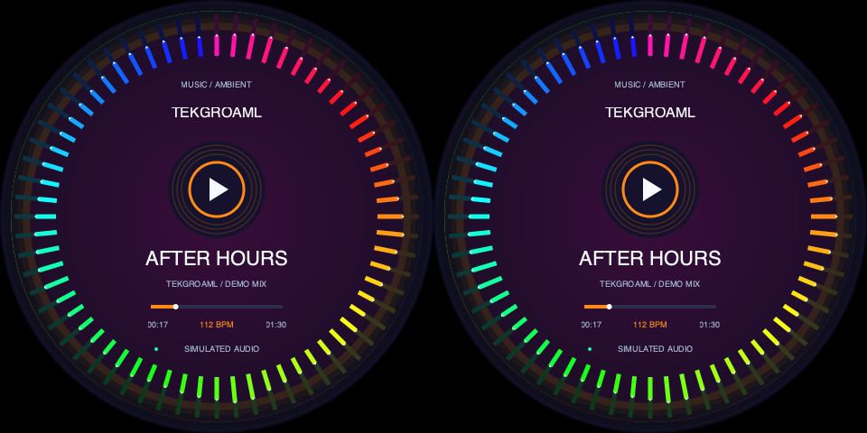
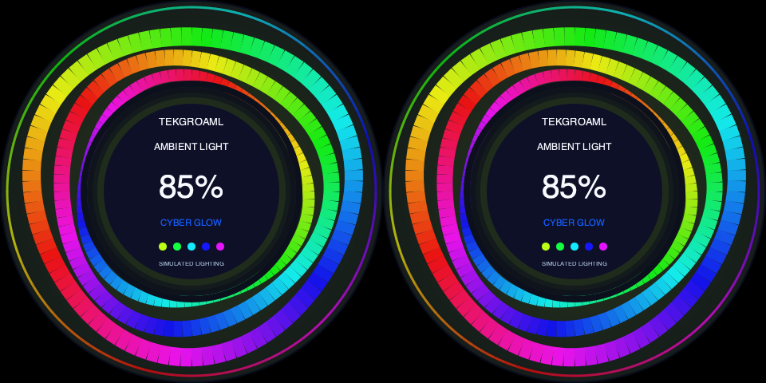
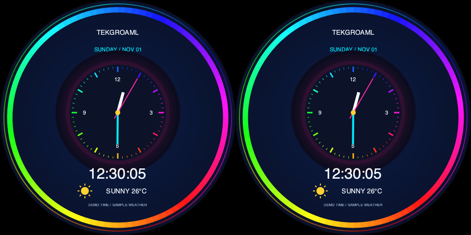

# Dual-round same-content product showcase

[中文](README.md) · [SSH installation](../../../docs/raspberry-pi-ssh_EN.md)

Version0.10.2. Music visualization → RGB ambient lighting → desktop information clock. Each chapter has a3s introduction and10s effect, looping every39s. Introductions and effects are identical on both panels, using vivid neon colors.

[Complete39s software preview](preview-loop.gif). Audio levels, brightness, time and weather are simulated. No sound playback/capture, weather service or physical lighting control is included.

## Install the full project

The Pi's Wayland/labwc desktop must remain logged in as the ordinary SSH user. Stop the old app before updating:

```bash
cd ~/apps/lvgl-embedded-gui-demos
./app stop --port 1
```

From your complete local repository, substitute your Pi hostname/address:

```bash
ssh pi@raspberrypi.local 'mkdir -p ~/apps/lvgl-embedded-gui-demos'
rsync -av --exclude=.git --exclude=.venv --exclude=__pycache__ --exclude=secrets ./ pi@raspberrypi.local:~/apps/lvgl-embedded-gui-demos/
```

Alternatively clone/pull the full GitHub repository once0.9.0 is published. Do not copy only this directory or overwrite a running installation. On the Pi:

```bash
cd ~/apps/lvgl-embedded-gui-demos
./setup.sh --install-only
./app --version
```

Verify0.10.0 or a later version containing this showcase. Existing system Python/GTK/Cairo dependencies are reused; no additional audio, browser or pip runtime packages are needed.

## Launch over SSH

The default is the current hardware-clone board: one480×480 input at60, approximately62.811 or71.295Hz, duplicated by the board.

```bash
./demos/same/round/demo check --port 1
./demos/same/round/demo start --port 1
```

start runs in the background after SSH exits while the desktop remains logged in. Stop separately when finished:

```bash
./demos/same/round/demo stop --port 1
```

Use status --port 1, logs --port 1 --follow, or restart --port 1. telemetry.scene cycles through music-ambient, ambient-light, ambient-clock; phase is intro/effect and cycle_index advances. Restart uses saved signal/size settings; stop and check/start after changing boards.

Default standard equivalent:

```bash
./app start --port 1 --shape round --panels 2 --input none --view product-showcase-same --layout product-showcase-same-clone-480 --content same --data-source demo
```

For SBS boards that split960×480 into two480×480 regions, stop first, then add --signal sbs to check/start. Software copies one raster to both halves. Physical scanning still depends on the board.

| --signal | --size | Full input | Refresh |
| --- | --- | --- | --- |
| clone (default) | 480 (default) | 480×480 | 60/~62.811/~71.295Hz |
| sbs | 480 | 960×480 | 60 or~62.825Hz |
| clone | 720 / 800 | 720×720 / 800×800 | 60Hz |
| sbs | 720 / 800 | 1440×720 / 1600×800 | 60Hz |

Other sizes require supporting hardware. Scale1 and normal rotation are checked; no EDID, pixel clock or timing settings are changed. port1/2 meansHDMI-A-1/2, not left/right panel. Both panels use one cable. No touch actions.

## Standalone scenes and code

Stop the current app before starting another scene. Hardware-clone view/layout pairs are music-ambient-clone/music-ambient-clone-480, ambient-light-clone/ambient-light-clone-480 and ambient-clock-clone/ambient-clock-clone-480, all using --shape round --panels 2 --input none --content same --data-source demo. SBS variants omit -clone in the view and use matching -sbs-480 layouts.

playlist.json owns copy, simulation offsets and durations. The fixed order accepts only the three declared same-content demo sources; no live or nested playlists. Restart after edits. demo_speed must remain1.

Actual scenes live under scenes/; common/neon.py shares color rings, glows and icons. The script reuses the existing timeline, standard lifecycle and raster duplication. Original round/square different-content showcases retain independent commands and playlists.







See[verification](../../../docs/verification.md) for software and device evidence. Software pixel equality does not certify physical scanout synchronization.

Version0.10.0 moves this implementation to demos/same/round, retaining the old command adapter. [Square same-content](../square/README_EN.md) uses separate retail/room/parcel applications. No Pi deployment was performed in this release.
