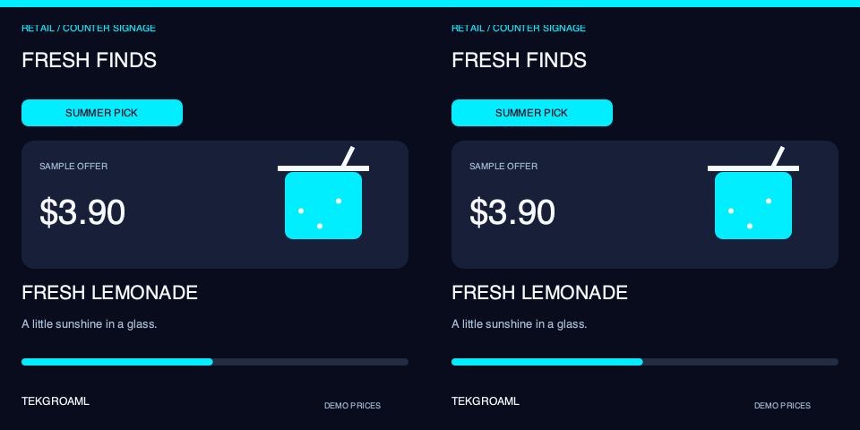
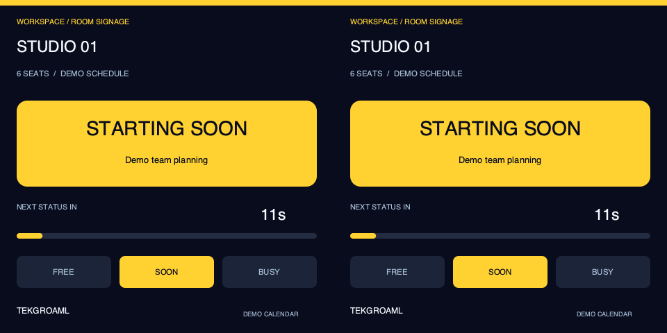
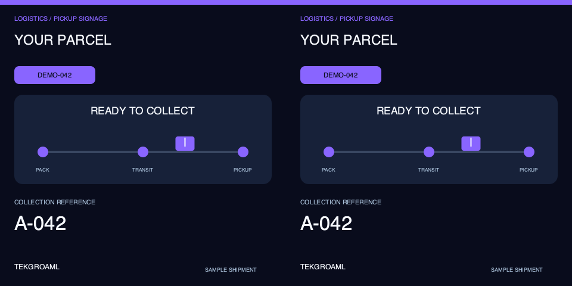

# 方形双屏同显：三用途演示

[English](README_EN.md) · [四类演示总目录](../../README.md) · [安装到Pi](../../../docs/raspberry-pi-ssh.md)

v0.10.2，区别于圆形同显的音乐、氛围和信息钟，方形使用适合文字与卡片展示的业务场景。每组先显示品牌＋场景图标＋用途介绍3秒，再演示应用10秒，一轮39秒循环。**介绍与效果均双屏相同**。

| 顺序 | 场景 | 自动变化 | 应用位置 |
| --- | --- | --- | --- |
| 1 | 门店促销看板 | 三种示例饮品、价格卡与进度 | 门店、咖啡柜台两侧 |
| 2 | 会议室状态牌 | 空闲→即将开始→使用中、倒计时 | 会议室入口、对向工位 |
| 3 | 物流取件状态屏 | 打包→运输→待取件、流动进度 | 自提点、物流柜台 |

全部演示数据，不连接真实商品价格、日历、物流订单或客户信息；没有触摸、声音或网络服务。颜色鲜艳，布局利用方屏四角。0.10.0先在本地验证；0.10.1随后按用户请求部署并启动，运行记录见验证文档，实体效果仍需观察。

## 更新完整项目

不能只复制本目录。若旧版本正在运行，先在Pi使用旧版本执行：

```bash
cd ~/apps/lvgl-embedded-gui-demos
./app stop --port 1
```

之后在Mac完整仓库根目录执行，用自己的Pi地址替换raspberrypi.local：

```bash
ssh pi@raspberrypi.local 'mkdir -p ~/apps/lvgl-embedded-gui-demos'
rsync -av --exclude=.git --exclude=.venv --exclude=__pycache__ --exclude=secrets ./ pi@raspberrypi.local:~/apps/lvgl-embedded-gui-demos/
```

GitHub包含0.10.0后可克隆或git pull --ff-only。已有机器先停止旧版再更新；建议保存旧副本用于回退。Pi普通用户已登录Wayland/labwc桌面，然后SSH执行：

```bash
cd ~/apps/lvgl-embedded-gui-demos
./setup.sh --install-only
./app --version
```

须为0.10.0或兼容后续版本。沿用系统Python/GTK/Cairo，不需要浏览器、pip或新依赖。

## 检查与启动

默认硬件同显板：一张480×480、60Hz或约62.811Hz输入，由板子复制给两个面板。

```bash
./demos/same/square/demo check --port 1
./demos/same/square/demo start --port 1
```

SBS板：输入960×480、左右各480×480，软件复制同一画面：

```bash
./demos/same/square/demo check --port 1 --signal sbs
./demos/same/square/demo start --port 1 --signal sbs
```

两种输入不能混用。换板前先正常stop，再检查信号并显式start。程序不改分辨率、EDID、时序或缩放。不匹配时拒绝启动，不推测当前实物能力。

| --signal | --size | 完整输入 | 刷新率 |
| --- | --- | --- | --- |
| clone（默认） | 480 | 480×480 | 60Hz或约62.811Hz |
| sbs | 480 | 960×480 | 60Hz |
| clone | 720 / 800 | 720×720 / 800×800 | 60Hz |
| sbs | 720 / 800 | 1440×720 / 1600×800 | 60Hz |

--size是每面板尺寸，其他尺寸按实际驱动板兼容选择。0.10.1已按此次接入信号为480克隆布局加入62.811001Hz，其他尺寸／SBS不自动扩大兼容范围。输出必须100%缩放、正常方向。port1/2对应HDMI-A-1/2（Pi4板标HDMI0/1），不是左／右面板。两块屏使用一根HDMI连接同一板。

## 状态与退出

```bash
./demos/same/square/demo status --port 1
./demos/same/square/demo logs --port 1 --follow
./demos/same/square/demo restart --port 1
```

start后台运行，SSH退出不停止，桌面须保持登录。restart使用保存的signal/size。结束时单独执行：

```bash
./demos/same/square/demo stop --port 1
```

status的telemetry.scene依次为store-signage、meeting-room、parcel-status；phase=intro/effect；cycle_index为轮次。默认等价命令：

```bash
./app start --port 1 --shape square --panels 2 --input none --view product-showcase-same-square --layout product-showcase-same-square-clone-480 --content same --data-source demo
```

## 单独应用与代码

实际应用在scenes/same/square/store_signage、meeting_room、parcel_status，各自有安装说明。单独启动使用对应view和layout，参考[场景目录](../../../scenes/README.md)。

playlist.json保存固定三个用途、图标、文案、模拟起点和3秒/10秒时长。修改后stop/start，摘要参与配置识别。demo_speed必须1。拒绝递归播放、live、错误形状或异显场景。

```text
demos/same/square/        方形同显脚本、介绍、播放列表、布局
scenes/same/square/       三个实际应用，各自model/panels/scene/layouts
demos/shared/            公共时间轴、命令、页面选择和图标
common/signage.py        方屏卡片、进度、视觉时钟
common/drawing.py        单光栅复制、clone去重绘制
```

[完整39秒软件预览](preview-loop.gif)。SBS预览的两个区域逐像素相同；硬件clone输入只含一幅方形图像。软件检查不能代替实体屏幕同步和信号验收。







[本地验证与限制](../../../docs/verification.md)。

0.10.1补充：此次新接入方形同显板上报480×480@62.811001Hz。clone-480布局现接受60和约62.811Hz，映射升为1.1.0；SBS与720/800仍保持60Hz。使用当前实际输入启动，不更改时序。

## 2026-11-01 — v0.10.1方形同显Pi运行

按用户启动请求检查到接口1已有480×480@62.811001Hz输入；为方形clone-480声明接受该实际速率并升映射至1.1.0，未改变设备时序。目标Pi125项测试全部通过，正常停止旧圆形演示、备份并更新后，方形三用途启动成功。连续41秒观测六阶段及下一轮，状态running/ok，帧数从10089增至11295。实体两屏观感未由用户确认，hardware_verified仍false。
