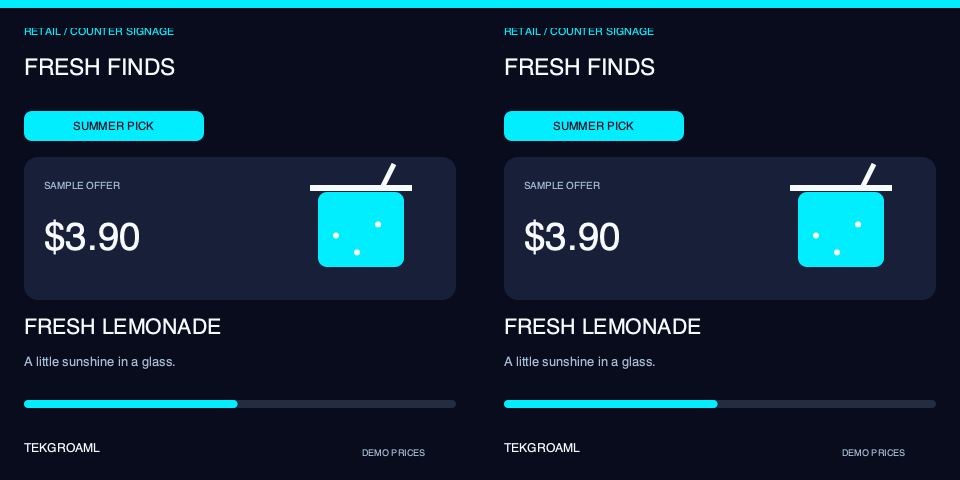
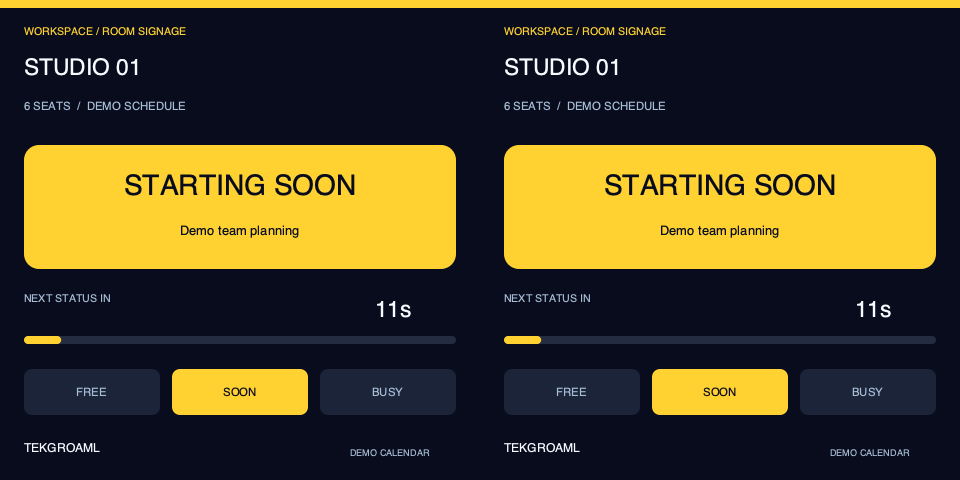
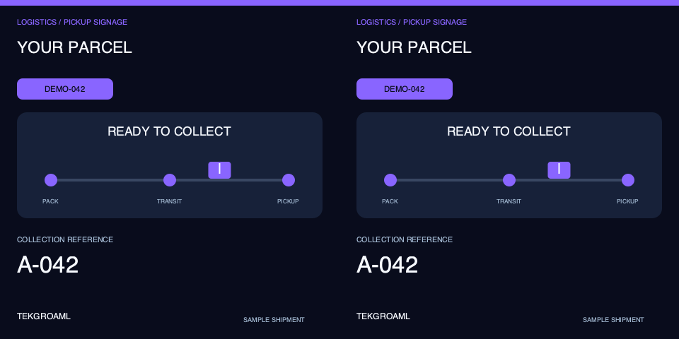

# Square same-content product showcase

[中文](README.md) · [Four demo families](../../README.md) · [SSH installation](../../../docs/raspberry-pi-ssh_EN.md)

Version0.10.0. Square-specific use cases: retail promotion, meeting-room availability and parcel pickup status. These differ from the round music/lighting/clock lineup. Each shows a3s brand/icon/use-case introduction then10s of automatic effects;39s loop. Both screens show identical introductions and effects.

All business data is simulated. No real prices, calendar, orders, customer data, touch, audio or network integration. This release is locally rendered only; the disconnected Pi display was not updated or started.

## Install and run over SSH

Stop the old version on the Pi first with./app stop --port 1. Copy the complete repository, not only this directory. From your local repository root:

```bash
ssh pi@raspberrypi.local 'mkdir -p ~/apps/lvgl-embedded-gui-demos'
rsync -av --exclude=.git --exclude=.venv --exclude=__pycache__ --exclude=secrets ./ pi@raspberrypi.local:~/apps/lvgl-embedded-gui-demos/
```

Substitute your Pi address. Alternatively clone/pull GitHub once0.10.0 is published. Do not overwrite a running installation. Keep the Pi desktop logged in as the same ordinary user; over SSH:

```bash
cd ~/apps/lvgl-embedded-gui-demos
./setup.sh --install-only
./app --version
./demos/same/square/demo check --port 1
./demos/same/square/demo start --port 1
```

Default: one480×480 at60Hz input, duplicated by a hardware-clone board. SBS boards require960×480; add --signal sbs to check/start. Other --size 720/800 layouts require matching square or double-width inputs at60Hz and supporting hardware. Square boards have not been physically verified; round-board refresh rates are not assumed. Output scale1 and normal rotation are checked. No EDID/timing configuration is changed.

Use status --port 1, logs --port 1 --follow, or restart --port 1. start survives SSH disconnection while the desktop stays logged in. Stop separately:

```bash
./demos/same/square/demo stop --port 1
```

port1/2 mapsHDMI-A-1/2, not the left/right panel. Two panels share one cable. The default standard equivalent is:

```bash
./app start --port 1 --shape square --panels 2 --input none --view product-showcase-same-square --layout product-showcase-same-square-clone-480 --content same --data-source demo
```

## Content and architecture

Retail cards change sample offers, room status cycles FREE/SOON/BUSY, parcel status moves through packing/transit/pickup. Actual models/pages live in scenes/same/square/. Each scene has its own installation and standard launch instructions. playlist.json owns bounded copy and3s/10s timing. Restart after edits; demo_speed must remain1. Recursive playlists, live sources, different-content scenes and crossed shapes are rejected.

Shared timing, CLI and panel selection live in demos/shared; same/different businesses have separate directories and scripts. Existing command adapters remain for compatibility without duplicate layouts or model implementations.

[39s preview](preview-loop.gif) is software-rendered and does not certify hardware scanout. See[verification](../../../docs/verification.md).






