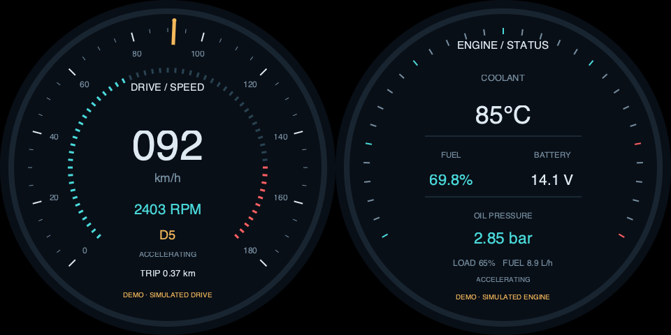

# v0.4.0 双圆汽车仪表

这是两块圆屏各自展示不同汽车信息的原生Python演示。新增--view automotive，原来的automotive-industrial混合视图保持兼容，两者不是同一布局。

## 两个圆形面板

| 面板 | 内容 |
| --- | --- |
| 左屏drive-speed | 车速指针和数字、RPM刻度环与数字、挡位D1～D5/N、行驶阶段、累计里程 |
| 右屏engine-status | 冷却液温度、燃油百分比、电压、机油压力、负载和瞬时耗油量 |

两页都在圆形区域内独立排版；标签、数值和模拟标记不使用方形角落。汽车左右两页共享同一份数据快照，在同一模拟时间下变化。



[查看加速演示动画](demo-automotive.gif)。动画将180秒模拟过程压缩成约14秒预览，实际程序默认按正常模拟时间运行。

## 当前双480圆屏的启动方式

在Pi进入已更新到v0.4.0的项目目录。先用旧版本正常stop再覆盖升级代码；不要运行中直接替换版本。

```bash
cd ~/apps/lvgl-embedded-gui-demos
./app --version
./app stop --port 1
./app check --port 1 --shape round --panels 2 --input none --view automotive --layout automotive-sbs-480 --content different --data-source demo
./app start --port 1 --shape round --panels 2 --input none --view automotive --layout automotive-sbs-480 --content different --data-source demo
```

新汽车场景的480布局接受960×480的60Hz和当前屏幕原生约62.825226Hz（±0.1Hz）；不改像素时钟、EDID或刷新率。只是允许应用按此画布绘制，不声称所有同EDID产品都已认证。

```bash
./app status --port 1
./app logs --port 1 --follow
./app stop --port 1
```

接口2时统一改--port 2。一根信号线的panels2仍只有一个HDMI输出，不是两根线。每面板720或800可用automotive-sbs-720/800，完整输入分别1440×720/1600×800，目前只接受60Hz。

已实现双圆汽车离屏检查；本轮没有替换Pi正在运行的飞行场景，没有宣称汽车已获实体屏幕确认。复制和安装流程见[独立SSH指南](raspberry-pi-ssh.md)。

## 自动数据逻辑

默认demo不用传感器、网络或额外包，启动后自动运动，始终标DEMO/SIMULATED。

- 每180秒经历怠速→加速→巡航→制动→怠速，速度连续。模拟道路巡航速度约100～108km/h。
- 挡位按车速切换，RPM由车速、轮胎周长、主减速比和挡位比关联计算；升挡时RPM回落，车速不回跳。面板对指针/数字做小幅平滑。
- 加速负载高于巡航和制动；水温约35秒热响应，制动/怠速后缓慢回落，不随油门瞬间变冷。
- 油压随RPM和温度联动，电压围绕发动机运行充电范围变化；这些是合理展示规则，不是ECU精密模型。
- 燃油按L/h对模拟时间积分，油量缓慢下降；里程按车速积分，只在移动时增加。循环不自动回满油或清零里程，应用重新启动才重置模拟状态。
- 数值读取不写入或控制真实车辆。汽车视图目前只支持demo，live/OBD未实现，传live会拒绝。

默认demo_speed=1，可用--config examples/demo-fast.json设置2倍模拟速度。它影响所有相关指标的共享模拟时间，不改变HDMI刷新率或真实输入文件。

## 场景目录

```text
scenes/automotive/
├── scene.py          精确形状/能力、面板与数据工厂
├── model.py          行驶阶段、挡位、温度、燃油与里程
├── panels.py         双圆汽车页面
└── layouts/          480/720/800三份版本化SBS映射
```

公共代码在common/，后台生命周期与HDMI定位在scene_app/。后续调整汽车外观或模拟模型只需改本目录；新增其他场景不向worker加入名字判断。
