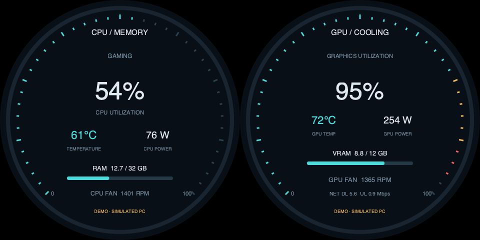

# v0.5.0 机箱电脑状态屏

本场景将小屏安装在电脑机箱上，树莓派通过一根HDMI驱动两个圆形面板：左CPU/内存，右GPU/散热。数据可以自主模拟，也可以来自被监控电脑的JSON。**不会读取Pi自身指标来假装Windows台式机指标。**

## 显示内容

| 面板 | 指标 |
| --- | --- |
| CPU / MEMORY | CPU使用率、CPU温度/功耗、内存占用/容量、CPU风扇RPM |
| GPU / COOLING | GPU使用率、GPU温度/功耗、显存占用/容量、GPU风扇RPM、网络速率 |



[加速自动演示](demo-pc-monitor.gif)。这是加速预览，实际默认按正常模拟时间运行。圆形安全区外保持黑色；未声明触摸操作或同显。

## 当前双480圆屏：先用demo验证

更新代码到v0.5.0后，在Pi项目目录执行；升级前先用旧代码正常停止旧实例，再复制整个项目。

```bash
cd ~/apps/lvgl-embedded-gui-demos
./app --version
./app stop --port 1
./app check --port 1 --shape round --panels 2 --input none --view pc-monitor --layout pc-monitor-sbs-480 --content different --data-source demo
./app start --port 1 --shape round --panels 2 --input none --view pc-monitor --layout pc-monitor-sbs-480 --content different --data-source demo
```

默认不需要外接电脑或传感器，自动循环“待机→CPU渲染负载→游戏负载→冷却”。CPU/GPU功耗随各自负载变化，温度有热惯性，风扇响应温度；冷却不会瞬间降到待机温度。CPU与GPU都读取同一模拟时刻，RAM/VRAM不会超过容量。始终标DEMO/SIMULATED。

可用--config examples/demo-fast.json加速模拟；不改变HDMI刷新率。

| 布局ID | 完整输入 | 每面板 |
| --- | --- | --- |
| pc-monitor-sbs-480 | 960×480，60Hz或原生约62.825Hz | 480×480 |
| pc-monitor-sbs-720 | 1440×720，60Hz | 720×720 |
| pc-monitor-sbs-800 | 1600×800，60Hz | 800×800 |

port1/2仍是HDMI-A-1/2，不是panel编号。软件接受这些模式不代表全部驱动板已实测；新PC场景尚未在实体屏验收。本轮不切换Pi当前画面，不改EDID、模式或USB。

## 真实电脑数据：Windows采集，Pi只负责展示

本仓库提供可选的scenes/different/pc_monitor/collectors/windows.ps1：

- 使用Windows自带Get-CimInstance读取真实CPU使用率与RAM占用/容量，不需要Python或pip。
- 电脑已安装并可调用nvidia-smi时，读取选定NVIDIA GPU的利用率、温度、显存和可用功耗。
- Windows系统接口不能可靠提供通用CPU核心温度、CPU功耗、风扇RPM；这些保持null。AMD/Intel GPU或无NVIDIA工具时，GPU字段同样保持缺失。
- nvidia-smi的fan.speed是百分比，不是RPM，脚本不会把它误标成转速。
- 网络速率、CPU温度和风扇可由用户已有监控软件后续提供同一JSON字段，不要求安装额外监控工程。

### 1. Windows：先本机采集

将项目复制到Windows，在PowerShell进入仓库根目录：

```powershell
# 仅采集一次，默认写入当前用户LOCALAPPDATA下Tekgroaml目录
.\scenes\pc_monitor\collectors\windows.ps1 -Once

# 持续采集，Ctrl+C停止
.\scenes\pc_monitor\collectors\windows.ps1 -IntervalSeconds 2
```

如系统脚本策略阻止执行，按本机管理规则审查并允许该脚本；不建议全局关闭执行策略。脚本应以当前用户运行，具体CIM/NVIDIA权限和驱动支持以目标PC验证为准。

### 2. Windows到Pi：已有SSH密钥登录时可自动同步

Windows需要可用的OpenSSH客户端ssh/scp。先交互验证用户、主机指纹和密钥登录，确认下面的命令能成功，不将密码放入脚本：

```powershell
ssh pi@raspberrypi.local
```

完成后退出该SSH会话，回到Windows PowerShell运行：

```powershell
.\scenes\pc_monitor\collectors\windows.ps1 -PiTarget pi@raspberrypi.local -IntervalSeconds 2
```

pi@raspberrypi.local必须换成自己的Pi用户/主机名/IP。自动同步使用BatchMode，要求密钥登录和已核对主机；只有密码认证时会明确失败，不会无限弹密码或保存凭据。

脚本在Pi用户目录~/.local/state/pc-monitor/input.json.new上传完成后原子重命名为input.json，避免显示程序读到半个JSON。一份目标文件只运行一个采集器。首次配置会建立该数据目录，不修改系统或开机自启动。

这里的SSH/scp负责Windows真实数据传输；日常启动界面仍可从Mac或其他电脑SSH到Pi操作。

### 3. Pi SSH：启动live显示

先让Windows采集器成功更新一次文件，再在Pi执行：

```bash
cd ~/apps/lvgl-embedded-gui-demos
./app stop --port 1
./app start --port 1 --shape round --panels 2 --input none --view pc-monitor --layout pc-monitor-sbs-480 --content different --data-source live --config examples/pc-monitor-live.json
./app status --port 1
```

examples/pc-monitor-live.json默认引用~/.local/state/pc-monitor/input.json。可复制到私有配置目录改input_file；相对路径以配置文件目录解释。

live明确显示LIVE及来源pc_name；不支持的GPU/温度/风扇显示“—”，真实0RPM显示0。采集器停止/网络失败后显示OFFLINE/LAST PC DATA并标stale，不悄悄切回demo。首次没有有效新鲜数据不会报告ready。

本轮Windows脚本未在真实Windows/NVIDIA环境执行；已验证的是Pi侧协议、缺失传感器、时效和软件绘图。目标Windows版本/驱动及SSH传输须各自实测。

## JSON协议：用于接入已有监控软件

examples/pc-monitor-snapshot.json是静态样本，sampled_at=0故意表示过期，不是实时采集数据。协议为schema_version=1。

| 字段 | 必需 | 单位／含义 |
| --- | --- | --- |
| sampled_at | 是 | **被监控电脑采样时的Unix秒数UTC**；不是Pi收到文件的时间 |
| pc_name | 是 | 来源电脑名称，1～32字符 |
| cpu_load_pct | 是 | 0～100% |
| memory_used_gb / memory_total_gb | 是 | GiB，已用≤容量；UI简写GB |
| cpu_temp_c / gpu_temp_c | 否 | °C；没有传感器用null |
| cpu_power_w / gpu_power_w | 否 | W |
| gpu_load_pct | 否 | 0～100% |
| vram_used_gb / vram_total_gb | 否 | GiB，成对提供，已用≤容量 |
| cpu_fan_rpm / gpu_fan_rpm | 否 | RPM；不能传风扇百分比 |
| download_mbps / upload_mbps | 否 | Mbit/s |
| workload | 否 | 如LIVE PC，自定义标签最多24字符 |

未知传感器省略或null，不能用0冒充可用。百分比、容量关系、有限数和上下界均校验。单个JSON最多64KiB，必须普通文件；FIFO/设备不阻塞界面。

Pi与Windows应校准时间。数据采样时间落后超过5秒、超前超过2秒就过期；文件刚上传也不能使旧数据“变新鲜”。无效/过期快照不覆盖最后有效数值，不生成模拟替代。

## 文件结构

```text
scenes/different/pc_monitor/
├── scene.py                 标准场景注册
├── model.py                 PcDemo与PcJsonSource
├── panels.py                两块圆形指标页
├── layouts/                 480/720/800映射
└── collectors/windows.ps1    可选Windows真实数据采集/同步
```

共用JSON文件读取在common/snapshots.py；其他场景也复用有界普通文件读取。标准GTK运行器不增加PC场景分支或本地传感器采集逻辑。
