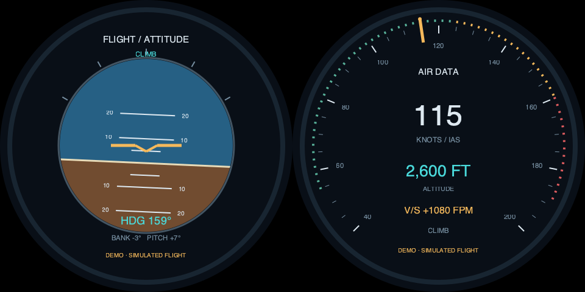
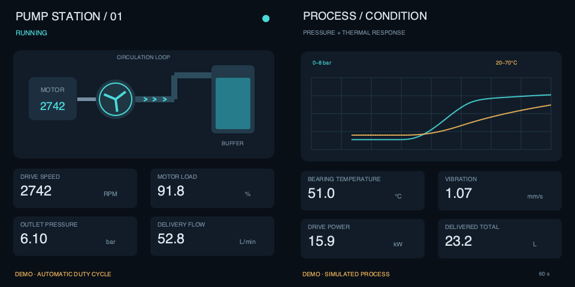

# v0.3.1：双圆飞行仪表与双方形泵站演示

两种新场景都在本项目内实现，使用同一./app标准入口和原生Python/GTK/Cairo。默认选择demo后，数据随运行时间自动变化；无需接传感器、飞行模拟器或网页服务。所有面板显示DEMO/SIMULATED标记，数据是用于展示的联动模型。

## 1. 双圆：飞行仪表盘

| 面板 | 内容 |
| --- | --- |
| panel1 | 人工地平仪：天空/地面、俯仰刻度、倾角、航向与飞行阶段 |
| panel2 | 空速表：刻度/指针、IAS节数、英尺高度与英尺/分钟升降率 |

两页各自设计在圆形安全区中，不将方形工业页面简单裁圆。它们展示同一飞行状态的不同仪表，所以仍是content different。

```bash
./app start --port 1 --shape round --panels 2 --input none --view flight --layout flight-sbs-480 --content different --data-source demo
```

模拟的是已经在空中的循环，不是从跑道起飞：约六分钟经过爬升、巡航、下降、平飞，然后连续进入下个循环。高度约2000～3200ft、空速约108～132kt，最大升降率约1080ft/min。阶段边界使用平滑过渡。

升降率由高度曲线的时间导数得到；俯仰由垂直速度/前进速度及小幅配平角得到。航向和倾角遵循协调转弯关系：右转时右倾、航向持续增大，反向转弯时符号相反，不会让多个表针无关地随机摆动。模型用于合理的视觉展示，不是完整飞行器动力学或实时飞行数据接入。

新flight视图仅支持demo。传入live会明确拒绝，不能把模拟数据标成真实飞行数据。



[查看飞行加速循环动画](demo-flight.gif)。动画将完整周期压缩到约11秒便于预览，应用默认仍按正常模拟时间运行。

## 2. 双方形：泵站运行与设备健康台

| 面板 | 内容 |
| --- | --- |
| panel1 | 电机/泵/管路示意，旋转叶片、流向、转速、负载、出口压力与瞬时流量 |
| panel2 | 压力/温度趋势、轴承温度、振动、驱动功率与累计输送量 |

```bash
./app start --port 1 --shape square --panels 2 --input none --view industrial --layout industrial-sbs-480 --content different --data-source demo
```

约两分钟自动循环：待机→软启动→运行→卸载→冷却。启动阶段转速上升，压力有响应延迟，流量和功率随运行负载联动；卸载后转速/流量回落，温度仍保持一段时间再冷却。

压力采用约3秒响应时间，温度采用约25秒热惯性。累计输送量对瞬时流量积分，跨循环持续增加，不随机跳变或每轮清零。动画中的泵叶转速随电机转速变化。右侧趋势保留约60秒模拟时间，压力与温度使用分别标出的量程。

场景只展示设备指标，不连接或控制真实泵站。新industrial视图仅demo；之前automotive-industrial混合视图仍保留原有live JSON协议。



[查看泵站加速循环动画](demo-industrial.gif)。这是约11秒的压缩预览，不代表实际设备响应时间。

## 3. 面板尺寸与完整信号

每个场景都有480/720/800三份SBS软件布局，signal、viewport和rect固定版本。flight-sbs-480现为v1.1.0，额外接受本次驱动板上报的约62.825226Hz（当前桌面62.825001Hz）；程序保留该原生信号，不切到60Hz。软件能画对应区域，不代表任意驱动板都支持该信号。

| 单面板 | 单线双屏完整输入 | 飞行layout | 泵站layout |
| --- | --- | --- | --- |
| 480×480 | 960×480、60Hz（flight另接受约62.825Hz） | flight-sbs-480 | industrial-sbs-480 |
| 720×720 | 1440×720、60Hz | flight-sbs-720 | industrial-sbs-720 |
| 800×800 | 1600×800、60Hz | flight-sbs-800 | industrial-sbs-800 |

shape单值广播到两个面板：round等价round,round，square等价square,square。--port只用1或2表示一个HDMI接口，不是面板编号。单个800×800圆屏不等于双800输入，不能在单屏模式下验证1600×800布局。

实际产品完整输入、左右分区、旋转和刷新率必须先配置正确。check不修改任何显示参数；不匹配直接拒绝。新布局仍标hardware_verified=false，实体双屏映射和长期运行待验收。

## 4. 自动演示速度

默认demo_speed=1按正常模拟时间运行，不需要任何外部操作。希望展台更快看到完整变化，可用配置改变演示时间倍率：

```bash
./app start --port 1 --shape round --panels 2 --input none --view flight --layout flight-sbs-480 --content different --data-source demo --config examples/demo-fast.json
```

examples/demo-fast.json设置demo_speed=2，将六分钟飞行循环压到三分钟，泵站两分钟压到一分钟。允许0.25～4；它只改变模拟时间，不改HDMI刷新率，也不将fps当作显示时序。正常使用无需这个文件。

所有数据共用同一个模拟时间，显示帧率不会改变模拟轨迹和物理响应。真实数据源不应用demo_speed。

## 5. 切换场景

先停止同一口当前实例，再启动另一模式：

```bash
./app stop --port 1
./app start --port 1 --shape square --panels 2 --input none --view industrial --layout industrial-sbs-480 --content different --data-source demo
./app status --port 1
./app logs --port 1 --follow
```

同应用同版本也可显式--replace，失败时尝试恢复原场景；不同版本升级先stop再更新代码。触摸和同显仍未声明，不会因为新增形状自动变为支持。

具体复制到Pi、安装依赖和SSH命令见[独立部署指南](raspberry-pi-ssh.md)。
