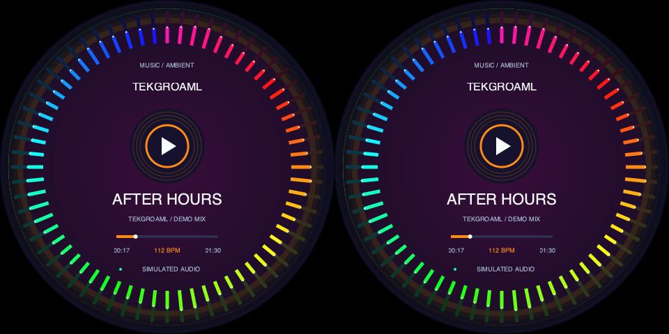

# 双圆同显：音乐律动与氛围灯

[English](README_EN.md) · [标准命令](../../../../docs/standard-app.md) · [SSH安装指南](../../../../docs/raspberry-pi-ssh.md)

v0.8.1软件预览。面向音箱两侧、机箱、游戏桌面的对称装饰，两块圆屏显示同一帧：64段环形频谱、渐变色光环、112 BPM节拍脉冲、中心播放图标、示例曲目和进度条。

0.8.0先在Mac本地实现；0.8.1增加硬件同显板适配。应先检查实际输入，再选择下述硬件同显或SBS同显命令。设备运行记录见验证文档。



[8秒动态预览](preview-loop.gif)。预览中的节拍与频谱是模拟，不包含音轨，不读取麦克风，也不播放声音。AFTER HOURS和DEMO MIX只是示例文案，中心三角形是播放状态图标，不是触摸按钮。

## 当前硬件同显板：480×480输入

有些双圆同显板只需要一张480×480图像，由驱动板复制到两个面板。它与需要960×480左右分区的SBS板是两种不同的输入结构，不要强制把480改成960。

屏幕当前上报480×480@约62.811Hz时，完整项目升级到0.8.1之后使用：

```bash
cd ~/apps/lvgl-embedded-gui-demos
./app check --port 1 --shape round --panels 2 --input none --view music-ambient-clone --layout music-ambient-clone-480 --content same --data-source demo
./app start --port 1 --shape round --panels 2 --input none --view music-ambient-clone --layout music-ambient-clone-480 --content same --data-source demo
```

同口已有应用时先正常./app stop --port 1。该布局topology=single-link-clone，两个物理面板共用一个480×480输入区域，软件只画一次，硬件负责复制。480布局接受60Hz或约62.811Hz；另有music-ambient-clone-720/800、单幅720×720/800×800、60Hz的软件布局，须硬件支持才可使用。

下方music-ambient-sbs-*命令适用于左右分区板，两种布局按实际信号选择，不按EDID显示器名称判断。程序不更改时序、EDID或信号尺寸。

## 画面设计

| 区域 | 表现 |
| --- | --- |
| 外圈 | 64段频谱随模拟低频／中频／高频变化，颜色随时间渐变 |
| 氛围层 | 8秒呼吸周期的光环，配合节拍扩张的中心细环 |
| 中央 | TEKGROAML品牌、播放图标、AFTER HOURS示例曲目 |
| 下方 | 90秒循环进度、时间、112 BPM、SIMULATED AUDIO标识 |
| 左右关系 | 同一软件帧复制到两个圆形区域，不反转、不做时间偏移 |

两个圆屏组成一根HDMI的SBS输入，默认总960×480，左右各480×480。应用先绘制一次，再将同一光栅复制到两个区域，保证输出帧两区像素一致。驱动板怎样扫描两个实体面板仍取决于硬件，本软件验证不认证物理刷新相位。

## 之后如何写入树莓派

本场景属于完整项目，不能只复制music_ambient文件夹。保留普通用户登录的Wayland/labwc桌面，通过SSH操作，不用sudo启动app。

**等当前演示结束后**，先在树莓派使用原版本正常停止：

```bash
cd ~/apps/lvgl-embedded-gui-demos
./app stop --port 1
```

然后在Mac的完整本地仓库根目录执行，用自己的树莓派主机名或地址替换raspberrypi.local：

```bash
ssh pi@raspberrypi.local 'mkdir -p ~/apps/lvgl-embedded-gui-demos'
rsync -av --exclude=.git --exclude=.venv --exclude=__pycache__ --exclude=secrets ./ pi@raspberrypi.local:~/apps/lvgl-embedded-gui-demos/
```

首次安装也可在包含v0.8.0代码的GitHub版本发布后，按[项目SSH指南](../../../../docs/raspberry-pi-ssh.md)克隆完整仓库。不要在正在播放的旧版本目录上直接覆盖代码；先停止，再更新，必要时保存旧目录用于回退。

## 之后如何通过SSH启动

更新完整项目后，在树莓派SSH终端执行：

```bash
cd ~/apps/lvgl-embedded-gui-demos
./setup.sh --install-only
./app --version
# 应为0.8.0或包含此场景的后续版本
./app check --port 1 --shape round --panels 2 --input none --view music-ambient --layout music-ambient-sbs-480 --content same --data-source demo
./app start --port 1 --shape round --panels 2 --input none --view music-ambient --layout music-ambient-sbs-480 --content same --data-source demo
```

依赖沿用系统Python、GTK、Cairo、layer-shell和wlr-randr，不新增音频、浏览器、pip或字体包。start后台运行，SSH退出后继续，桌面须保持登录。不同应用版本须先停止旧实例。

稍后停止时单独执行：

```bash
./app stop --port 1
```

状态、日志与重启：

```bash
./app status --port 1
./app logs --port 1 --follow
./app restart --port 1
```

正常status会显示features.content=same、view=music-ambient和模拟MusicData；不是连接到真实音乐的证明。图形桌面或驱动板未连接时，check/start会拒绝，不自动重设显示信号。

## 尺寸、接线与信号

| layout | 每屏 | 完整输入 | 接受刷新率 |
| --- | --- | --- | --- |
| music-ambient-sbs-480 | 480×480 | 960×480 | 60Hz或约62.825Hz |
| music-ambient-sbs-720 | 720×720 | 1440×720 | 60Hz |
| music-ambient-sbs-800 | 800×800 | 1600×800 | 60Hz |

SBS布局默认接口1对应HDMI-A-1（Pi4板标HDMI0），接口2对应HDMI-A-2（板标HDMI1）。--panels 2是同一个HDMI信号内的左右两块面板，不代表连接两个HDMI口。应用要求scale1、正常输出方向；不修改像素时钟、EDID、分辨率或刷新率。需事先确认驱动板接受完整输入，并能正确分到两个圆屏。

## 与现有异显场景的关系

music-ambient和music-ambient-clone只接受--content same。飞机、汽车、机箱、家居、工业和两个串联演示仍要求--content different，传错会拒绝。新场景没有加入原有39秒播放列表，启动方屏异显演示的命令保持原样。

之后恢复方屏异显演示时：

```bash
./app stop --port 1
./demos/different/square/demo start --port 1
```

圆屏切回原三用途用./demos/different/round/demo start --port 1。先确认实物形状和完整信号相符；本场景没有自动部署或自动启动功能。

## 代码结构与本地预览

```text
scenes/same/round/music_ambient/
  scene.py          同显能力、布局与工厂声明
  model.py          确定性节拍／频段／呼吸／颜色模拟
  panels.py         原生圆屏矢量绘图和帧间视觉时钟
  layouts/          480、720、800双圆SBS布局
  preview.png       实际Cairo离屏截图
  preview-loop.gif  8秒软件动画预览
```

同显复制位于common/drawing.py；content_modes由每个SceneDefinition声明，能力清单从注册表生成。数据源不启动音频进程、不采集系统音频、不访问网络，也不读取歌曲文件。

已安装现有Cairo运行环境时，可只做离屏绘图，不打开屏幕窗口：

```bash
python3 tests/render_native.py --view music-ambient --size 480 --elapsed 12 --output /tmp/music-ambient-preview.png
```

标准库测试为python3 -m unittest discover -s tests -q；没有Cairo时会跳过真实光栅测试，完整绘图验证需有Cairo。本次Mac本地以临时Cairo绑定和已有原生库执行100项测试全部通过，并完成三个尺寸18张离屏绘图。9个既有场景与旧渲染器逐像素一致。没有树莓派或实体圆屏运行验收；详见[验证记录](../../../../docs/verification.md)。

## 0.8.1硬件同显运行记录

2026-11-01已按用户要求部署到目标Pi。104项测试在Pi全部通过，music-ambient-clone-480启动成功；480×480@62.811001Hz输入与更新前一致，状态running/ok，持续观测帧数递增。应用只输出一幅圆形画面，由驱动板复制到两个实体屏。实体两屏的完整性和同步效果待用户确认，不据此标记通用硬件认证。

## 三用途同显脚本（0.9.0）

音乐页面现已改为更鲜艳的霓虹配色。要循环展示音乐、RGB氛围和桌面信息钟，先./app stop --port 1，再./demos/same/round/demo start --port 1。默认硬件clone；SBS板加--signal sbs。详见[完整脚本指南](../../../../demos/same/round/README.md)。
