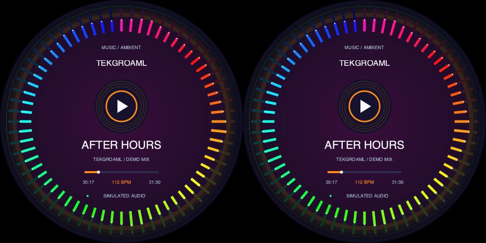

# Dual-round same-content music and ambient lighting

[中文](README.md) · [SSH installation](../../../../docs/raspberry-pi-ssh_EN.md)

Version0.8.1 software preview. Two identical circular displays for speakers, PC cases or gaming desks:64 animated radial bands, a breathing halo, simulated112 BPM pulses, a decorative play icon, sample track information and progress.

Version0.8.0 was initially implemented on the Mac only. Version0.8.1 adds hardware-clone input mapping; select the layout matching the actual signal. See the verification record for deployment evidence.



[8s animated preview](preview-loop.gif). No soundtrack, audio capture, playback or real spectrum analysis is included. AFTER HOURS is sample copy; the play icon is decorative and has no touch action.

## Hardware-clone boards: one480×480 input

Some two-panel boards duplicate one square signal in hardware. If the connected board reports480×480 at~62.811Hz, use the following after updating the complete project to0.8.1 and stopping the old instance:

```bash
./app check --port 1 --shape round --panels 2 --input none --view music-ambient-clone --layout music-ambient-clone-480 --content same --data-source demo
./app start --port 1 --shape round --panels 2 --input none --view music-ambient-clone --layout music-ambient-clone-480 --content same --data-source demo
```

The app draws one circle; the board duplicates it. topology=single-link-clone differs from the double-width SBS layouts below. Do not force960×480 on a480×480 board. Clone480 accepts60 or~62.811Hz; optional720/800 clone layouts require matching square inputs at60Hz and supporting hardware. No timing or EDID changes are made.

## Install the complete project later

Keep the Pi desktop logged in as the same normal user. After the current presentation finishes, stop the old version first on the Pi:

```bash
cd ~/apps/lvgl-embedded-gui-demos
./app stop --port 1
```

From the complete repository directory on your computer, substitute your Pi hostname/address:

```bash
ssh pi@raspberrypi.local 'mkdir -p ~/apps/lvgl-embedded-gui-demos'
rsync -av --exclude=.git --exclude=.venv --exclude=__pycache__ --exclude=secrets ./ pi@raspberrypi.local:~/apps/lvgl-embedded-gui-demos/
```

Alternatively clone/pull the complete GitHub project once a version containing0.8.0 is published. Do not overwrite a running installation. Use the[SSH guide](../../../../docs/raspberry-pi-ssh_EN.md) for initial setup. No additional audio, browser or pip packages are required on the Pi.

## Launch over SSH later

```bash
cd ~/apps/lvgl-embedded-gui-demos
./setup.sh --install-only
./app --version
./app check --port 1 --shape round --panels 2 --input none --view music-ambient --layout music-ambient-sbs-480 --content same --data-source demo
./app start --port 1 --shape round --panels 2 --input none --view music-ambient --layout music-ambient-sbs-480 --content same --data-source demo
```

Verify0.8.0 or a later release containing this scene. start stays in the background after SSH exits while the desktop remains logged in. Later use./app stop --port 1, status --port 1, logs --port 1 --follow, or restart --port 1. Stop old versions before upgrading. No auto-start is installed.

## Display and implementation

One HDMI carries two same-size round regions side by side. Default layout music-ambient-sbs-480 requires960×480 at60 or approximately62.825Hz. The720/800 layouts require1440×720/1600×800 at60Hz. Scale1 and normal output rotation are required. port1/2 meansHDMI-A-1/2, not the left/right panel. The app never changes timings, EDID or display configuration.

The renderer draws one raster tile and copies it to both regions, giving identical software pixels without independent animation state or mirrored graphics. Physical scanout synchronization still depends on the driver board. No hardware certification is inferred from the preview.

scene.py declares content_modes=('same',); model.py generates deterministic envelopes,8s breathing, color changes and90s track progress; panels.py draws vectors. A visual clock advances between telemetry polls without reading local wall time. Existing scenes still require --content different and the39s playlists are unchanged. Switch back later by stopping this scene and running./demos/different/square/demo start --port 1 for square panels or./demos/different/round/demo start --port 1 for round panels.

With the existing Cairo environment, generate a PNG without opening a window:

```bash
python3 tests/render_native.py --view music-ambient --size 480 --elapsed 12 --output /tmp/music-ambient-preview.png
```

Local validation:100 tests passed with a temporary Cairo binding and the existing native library;18 renders across three sizes verified identical halves. All9 existing scenes matched the previous renderer pixel for pixel. No Pi deployment or physical display test was performed. See[verification](../../../../docs/verification.md).

## 0.8.1 Pi runtime record

Deployed at user request on2026-11-01. All104 tests passed on the Pi; music-ambient-clone-480 started and remained running/ok with advancing frames. The existing480×480@62.811001Hz signal was preserved. Physical observation of both panels is pending; this does not certify generic hardware synchronization.
